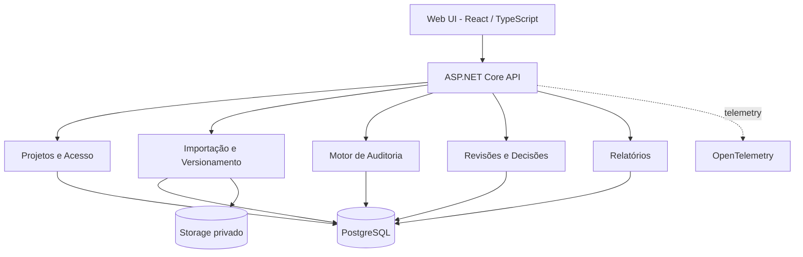
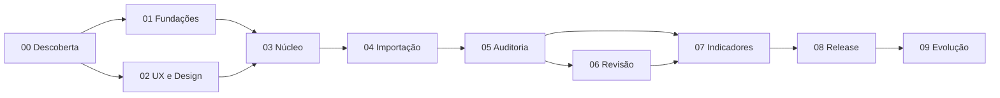

# CronoCheck — Blueprint de Produto, Arquitetura e Plano de Execução

**Versão:** 1.0 (baseline proposta)  
**Data:** 14/10/2026  
**Status:** planejamento; nenhuma implementação é presumida  
**Premissa:** plataforma web de auditoria e governança de cronogramas, com backend C#/.NET e frontend React/TypeScript.  
**Autoridade de decisão:** responsável pelo produto e revisão humana. Automação/IA podem apoiar a implementação e os testes, mas não substituem as evidências nem a aprovação.

> Este documento é um plano de trabalho, não um relato de funcionalidades já implementadas. Prazos, SLAs e metas são propostas a confirmar após a fase 00.

---

## A. Sumário executivo

### A.1 Problema
Cronogramas são importados, alterados e analisados por diferentes profissionais, mas falhas de estrutura, dependências, versões e rastreabilidade são difíceis de detectar e explicar. Revisões manuais são lentas e decisões frequentemente ficam fora do histórico do planejamento.

### A.2 Proposta de valor
Uma plataforma para importar cronogramas, normalizar dados, executar regras determinísticas de auditoria, mostrar evidências, coordenar revisões e comparar versões. A plataforma **não altera automaticamente o arquivo original**.

### A.3 Público inicial
Planejadores de obras e projetos, coordenadores de planejamento e auditores técnicos. Usuários e requisitos reais precisam ser validados na fase 00.

### A.4 Princípios de produto
1. **Ação antes de dashboard:** a interface apresenta pendências e próximos passos, não só gráficos.
2. **Explicabilidade:** cada achado apresenta regra, entradas, cálculo/condição e resultado.
3. **Reprodutibilidade:** mesmas entradas e versão das regras produzem os mesmos achados, exceto campos externos explicitamente versionados.
4. **Não destrutividade:** importações e auditorias geram novas versões; a origem é preservada.
5. **Segurança e privacidade por padrão:** permissões por projeto, retenção definida e minimização de dados.
6. **Complexidade proporcional:** modularização desde o início; microsserviços e infraestrutura distribuída apenas quando houver motivo mensurável.

### A.5 MVP: incluído
- Contas/acesso com papel por projeto; cadastro de projetos.
- Importação **.xlsx** com modelo de colunas documentado; mapeamento assistido e pré-visualização.
- Armazenamento de arquivo de origem com hash SHA-256 e versão de cronograma normalizada.
- Auditorias determinísticas versionadas: datas inválidas, IDs duplicados, referências inexistentes, predecessoras circulares, atividades desconectadas conforme política e inconsistências simples de duração/dependência.
- Fila de achados com filtros, detalhes e evidências por regra; estados de revisão e justificativas.
- Histórico de auditorias e eventos de negócio; comparação básica entre duas versões.
- Dashboard operacional e exportação CSV/PDF de resultados resumidos.
- Ambientes local/teste/produção, logs estruturados, testes automatizados, backup e processo de lançamento.

### A.6 Fora do MVP
Leitura nativa de `.mpp`, integração online com Project/Primavera, edição automática do cronograma, CPM multicritério com calendários complexos, Monte Carlo, IA generativa, marketplace de plugins, modo offline, cobrança/SaaS multiempresa e microsserviços. São possibilidades para a fase 09, não promessas.

### A.7 Jornada primária
**Entrar → Selecionar projeto → Importar XLSX → Mapear colunas → Conferir prévia/validar → Confirmar versão → Executar auditoria → Revisar achados → Registrar decisões → Comparar versões → Exportar relatório**.

---

## B. Requisitos rastreáveis

### B.1 Requisitos funcionais (RF)
| ID | Requisito | Marco inicial | Evidência |
|---|---|---|---|
| RF-01 | Autenticar usuário e verificar permissões em cada projeto | F03 | Testes de acesso positivo e negativo |
| RF-02 | Cadastrar, listar e consultar projetos | F03 | API + fluxo E2E |
| RF-03 | Receber XLSX e validar extensão, conteúdo, limites e permissões | F04 | Fixtures válidas e malformadas |
| RF-04 | Mapear colunas e mostrar prévia antes da gravação | F04 | Teste de interface + contrato |
| RF-05 | Persistir arquivo original, hash e snapshot normalizado versionado | F04 | Teste de integridade e persistência |
| RF-06 | Executar regras de auditoria determinísticas e versionadas | F05 | Golden datasets e testes unitários |
| RF-07 | Exibir regra, evidências e tarefas relacionadas em cada achado | F05 | Contrato + teste E2E |
| RF-08 | Classificar, atribuir, comentar e decidir achados | F06 | Máquina de estados + trilha de auditoria |
| RF-09 | Comparar versões e sinalizar alterações relevantes | F07 | Teste com duas versões conhecidas |
| RF-10 | Exportar resultados de auditoria em formato legível e estruturado | F07 | Teste de conteúdo/exportação |
| RF-11 | Consultar histórico de ações e execuções | F06–F07 | Consulta por ator, tempo e entidade |

### B.2 Requisitos não funcionais (RNF) — metas **propostas**
| ID | Categoria | Meta inicial mensurável | Forma de validar |
|---|---|---|---|
| RNF-01 | UX | Fluxo principal sem bloqueios; sistema comunica erros/espera/repetição | Testes com usuários e E2E |
| RNF-02 | Acessibilidade | WCAG 2.2 nível AA nos fluxos essenciais | Testes automatizados + revisão manual |
| RNF-03 | Resposta | p95 de consultas usuais < 500 ms em cenário de referência, sem processamento de importação | Teste de carga com base documentada |
| RNF-04 | Processamento | 5.000 atividades XLSX em até 60 s em ambiente de referência, alvo ajustável após benchmark | Benchmark reprodutível |
| RNF-05 | Confiabilidade | Importação e auditoria idempotentes; reprocessamento sem duplicar versões/achados | Testes de retry e concorrência |
| RNF-06 | Segurança | Sem vulnerabilidade crítica ou alta conhecida não mitigada na liberação | SAST/SCA e revisão OWASP ASVS |
| RNF-07 | Rastreamento | 100% das mutações críticas têm evento de auditoria ligado à transação | Testes de integração |
| RNF-08 | Recuperação | Backup diário testado; **alvos** RPO 24 h e RTO 4 h | Ensaio real de restauração |
| RNF-09 | Operação | Trace/correlation ID em importação, auditoria e erros de API | Teste de observabilidade |
| RNF-10 | Contratos | API documentada e mudanças incompatíveis identificadas em CI | Validação OpenAPI |

As metas de desempenho e recuperação não constituem promessa de SLA. Devem ser confirmadas considerando orçamento, infraestrutura e uso real.

---

## C. Arquitetura alvo

### C.1 Decisões iniciais a registrar em ADRs
- **ADR-001 — Monólito modular:** um deploy do backend, módulos com fronteiras explícitas e sem acesso direto a tabelas internas de outros módulos.
- **ADR-002 — Frontend separado:** React + TypeScript para uma interface rica; backend ASP.NET Core em C#.
- **ADR-003 — Persistência:** PostgreSQL + EF Core, migrações versionadas e política de backup/restore.
- **ADR-004 — Importação:** `.xlsx` com biblioteca apropriada; camada `Parser -> Mapping -> Canonicalizer -> Validation -> Commit`.
- **ADR-005 — Auditoria:** regras puras e versionadas, snapshots de entrada, resultados explicáveis.
- **ADR-006 — Execução longa:** jobs persistentes com estados, tentativas controladas e idempotência; broker externo só se necessário.
- **ADR-007 — Segurança:** autenticação padronizada, autorização por recurso/projeto e logs sem segredos.
- **ADR-008 — Eventos:** eventos de auditoria escritos atomicamente com a alteração de negócio sempre que possível; outbox para publicação externa quando surgir necessidade.

### C.2 Stack proposta
| Preocupação | Base |
|---|---|
| API e domínio | C# / .NET 10 LTS / ASP.NET Core |
| Interface | React + TypeScript + Vite (SPA) |
| Sistema visual | Tailwind CSS + componentes acessíveis baseados em Radix/shadcn/ui, tokens próprios |
| Dados | PostgreSQL / EF Core |
| Arquivos | Storage privado compatível com S3 ou storage local em desenvolvimento |
| Autenticação | Provedor OIDC ou solução consolidada equivalente; nunca criptografia/autenticação caseira |
| Testes backend | xUnit, testes de integração com PostgreSQL efêmero |
| Testes frontend | Vitest + Testing Library + Playwright |
| Contratos | OpenAPI + validação de schema |
| Operação | Docker Compose em desenvolvimento, GitHub Actions, OpenTelemetry |

A decisão sobre Vite/Next.js, provedor OIDC e hospedagem será fechada nas ADRs da fase 01; não são dependências irrevogáveis.

### C.3 Componentes e responsabilidades


### C.4 Organização inicial de repositório
```text
cronocheck/
  apps/
    web/                         # React/TypeScript
  backend/
    CronoCheck.slnx
    src/
      CronoCheck.Api/            # Entry point e composition root
      CronoCheck.SharedKernel/   # Tipos compartilhados mínimos
      Modules/
        Projects/
        Imports/
        Audits/
        Reviews/
        Reports/
    tests/
      Unit/
      Integration/
      Architecture/
  tests/
    e2e/                        # Testes de jornada
    fixtures/                   # XLSX representativos e esperados
  infra/
    docker/
    migrations/
    observability/
  docs/
    product/
    architecture/adr/
    api/
    ux/
    operations/
    decisions/
  .github/
    workflows/
    ISSUE_TEMPLATE/
    PULL_REQUEST_TEMPLATE.md
    CODEOWNERS
  AGENTS.md                      # Somente instruções operacionais verificáveis, sem autoridade decisória
  README.md
  CONTRIBUTING.md
  SECURITY.md
  CHANGELOG.md
  .editorconfig
```

> `SharedKernel` deverá permanecer pequeno; comunicação intermodular deve ocorrer por contratos públicos explícitos. Dependências cíclicas entre módulos serão bloqueadas em testes de arquitetura.

### C.5 Entidades e invariantes principais
- `Workspace/Project`: limites de autorização e contexto operacional.
- `ProjectMembership`: usuário, papel e escopo.
- `ScheduleImport`: upload, origem, SHA-256, autor, estado, resultados de validação.
- `ScheduleVersion`: ID e número imutáveis por projeto, snapshot normalizado e hash.
- `Activity`: identificador canônico, identificador de origem, título, datas, duração, hierarquia opcional.
- `Dependency`: predecessora, sucessora, tipo e defasagem; no MVP restringir tipos suportados e rejeitar/avisar explicitamente sobre os demais.
- `AuditRun`: versão de cronograma, versão do conjunto de regras, timestamps, status, correlation ID.
- `Finding`: regra, versão da regra, severidade, entidades afetadas, evidências, fingerprint.
- `FindingReview`: estado, responsável, decisão, justificativa e histórico.
- `AuditEvent`: ator, ação, recurso, timestamp UTC, request/correlation ID, delta seguro e resultado.

**Invariantes:** versões de origem não sobrescritas; autorização verificada no backend; transições de estado explícitas; eventos críticos persistidos na mesma transação; identificadores de origem preservados; timestamps em UTC e apresentação local; exclusões lógicas/retenção avaliadas conforme obrigação legal; exportações exigem autorização.

### C.6 Importação segura e reprodutível
1. Validar tamanho, permissão, tipo real e integridade; não confiar apenas na extensão.
2. Armazenar em local privado sem execução, acesso público ou formula evaluation automática.
3. Detectar planilhas/colunas e oferecer mapeamento com prévia; especificar timezone, formato de datas e unidade de duração.
4. Canonicalizar para modelo tipado preservando identificadores originais e warnings.
5. Gerar registro de validação: erros impeditivos separados de alertas informativos.
6. Confirmar transação de criação de versão; exigir idempotency key ou fingerprint apropriado.
7. Executar auditoria vinculada à versão e ao conjunto de regras.
8. Tratar fórmulas como conteúdo não confiável; escapar valores perigosos em saídas CSV e impor limites de recursos contra arquivos maliciosos/zip bombs.

### C.7 Motor de auditoria
- Cada regra tem `RuleId`, `Version`, `Severity`, `Description`, `Parameters`, `EvidenceSchema` e testes com fixtures.
- Separar erro de importação, inconsistência de dados, aviso heurístico e risco de prazo.
- Regras **MVP**: IDs duplicados; datas incoerentes; duração negativa/inválida; referência a atividade inexistente; laço no grafo de precedência; atividade órfã segundo política configurada; incompatibilidade temporal em vínculos FS simples (com calendário/duração explicitamente limitados).
- Algoritmos: validação de domínio + DFS/Tarjan para ciclos; identificação estável de achados; complexidade e limites documentados.
- Reexecução gera novo `AuditRun`; não altera retrospectivamente resultados históricos.
- Achados incluem evidências legíveis por humanos e exportáveis em JSON estruturado.

---

## D. UX, UI e fluxos

### D.1 Informação e navegação
Navegação principal: **Projetos**, **Importações**, **Auditorias**, **Pendências**, **Relatórios**, **Configurações**. Contexto de projeto permanece explícito em todas as telas; filtros e paginação persistem na navegação de retorno.

### D.2 Telas mínimas
1. Acesso e seleção de projeto.
2. Home operacional do projeto (próxima ação, importações recentes, pendências críticas).
3. Wizard de importação (arquivo, mapeamento, validação, confirmação).
4. Lista de versões e auditorias.
5. Lista de achados (filtro, busca, ordenação, severidade, responsável e status).
6. Painel de detalhe de achado (evidências, regra, atividades, histórico, decisão).
7. Comparação de versões (adicionados, removidos, modificados, achados novos/resolvidos).
8. Relatórios e exportações.
9. Administração de membros e papéis.

### D.3 Padrões de experiência obrigatórios
- Empty/loading/success/error/permission-denied/offline-like states por tela.
- Operações longas são assíncronas e mostram estados reais do servidor, com atualização recuperável após refresh.
- Formulários validam próximo ao campo e exibem erro global quando necessário.
- Navegação por teclado, foco visível, semântica apropriada, contraste e leitores de tela.
- Diálogos destrutivos exigem confirmação contextual; não usar apenas toast para informação irreversível.
- Animações leves e reduzidas via `prefers-reduced-motion`; virtualização apenas quando necessária.
- Uso de tokens (cor, espaçamento, tipografia, densidade, elevação); no mínimo tema claro e responsividade; tema escuro pode ser pós-MVP.

### D.4 Testes de usabilidade
Roteiros com tarefas representativas: importar, corrigir mapeamento, localizar achado, justificar exceção, comparar versões, exportar. Registrar sucesso da tarefa, tempo, erros e percepção, sem presumir conclusões antes do teste.

---

## E. Plano de execução por fases e etapas (WBS)

**Convenção:** `FNN-ENN` = fase/etapa; tickets específicos se desdobram em `TASK`, `TEST` e `DOC`. Cada etapa tem entregável e critério de saída. Os prazos representam uma hipótese de planejamento, não promessa.

### FASE 00 — Descoberta, escopo e requisitos (1–2 semanas)
**Objetivo:** decidir o que construir, para quem, com quais limites e resultados observáveis.

| Etapa | Atividades essenciais | Entregável | Aceite / gate |
|---|---|---|---|
| F00-E01 | Entrevistar usuários-alvo e registrar cenários reais | `docs/product/personas-jtbd.md` | 3–5 cenários priorizados e validados, ou limitações explicitadas |
| F00-E02 | Descrever jornada atual e pontos de dor | Mapa AS-IS / TO-BE | Jornada primária completa e hipóteses registradas |
| F00-E03 | Delimitar MVP, fora de escopo e matriz de requisitos | PRD + RF/RNF + critérios | Escopo testável e backlog inicial aprovado |
| F00-E04 | Definir formato XLSX de referência, calendário e regras | Contrato de importação v0 | Fixtures representativas e casos extremos catalogados |
| F00-E05 | Criar riscos, prioridades e definição de sucesso | Registro de riscos e KPIs | Gate G0 aprovado; sem decisões críticas implícitas |

**Gate G0:** PRD baseline, dados de teste anonimizados, histórias prioritárias e decisões abertas catalogadas.

### FASE 01 — Arquitetura e fundações técnicas (2–3 semanas)
**Objetivo:** estabelecer a base para desenvolvimento incremental sem dívida estrutural prematura.

| Etapa | Atividades essenciais | Entregável | Aceite / gate |
|---|---|---|---|
| F01-E01 | Selecionar stack, delimitar módulos e publicar ADRs | C4 nível 1/2 + ADRs | Dependências permitidas documentadas |
| F01-E02 | Montar monorepo, soluções .NET, frontend e convenções | Scaffold compilável | Build local com um comando documentado |
| F01-E03 | Configurar PostgreSQL, migrações e ambiente local | Docker Compose + migração inicial | Setup limpo reproduzível |
| F01-E04 | Configurar CI, formatadores, analyzers, testes e scanners | Workflows GitHub Actions | PR de teste bloqueado se check falhar |
| F01-E05 | Padronizar API (erro, auth placeholder, validação, paginação) | OpenAPI baseline | Contratos verificados e testes smoke |
| F01-E06 | Criar observabilidade mínima e health checks | Logs estruturados + tracing base | Correlation ID visível de ponta a ponta |

**Gate G1:** repositório reproduzível, pipeline verde, arquitetura documentada e nenhum segredo versionado.

### FASE 02 — UX/UI e design system (2–3 semanas; paralelizável)
**Objetivo:** validar fluxos e sistema visual antes de escalar as telas.

| Etapa | Atividades essenciais | Entregável | Aceite / gate |
|---|---|---|---|
| F02-E01 | Mapear arquitetura de informação e fluxos de navegação | Sitemap + user flows | Importação e revisão resolvidas sem caminhos ambíguos |
| F02-E02 | Elaborar wireframes de baixa fidelidade | Fluxos clicáveis | Revisão orientada a tarefas concluída |
| F02-E03 | Definir tokens, componentes e estados do design system | Biblioteca de componentes | Estados, foco, erros e responsividade definidos |
| F02-E04 | Criar protótipo de alta fidelidade das telas críticas | Protótipo navegável | Fluxo importação→achado compreensível |
| F02-E05 | Testar com usuários e ajustar fricções | Registro de testes e mudanças | Bloqueadores críticos resolvidos |
| F02-E06 | Implementar shell da UI e testes de acessibilidade base | Layout navegável e testável | Navegação teclado e testes iniciais passando |

**Gate G2:** padrão visual coerente, rotas principais definidas, protótipo aprovado e requisitos de acessibilidade abordados.

### FASE 03 — Núcleo operacional e segurança (3–4 semanas)
**Objetivo:** estabelecer identidade, permissões, projetos e trilha de ações.

| Etapa | Atividades essenciais | Entregável | Aceite / gate |
|---|---|---|---|
| F03-E01 | Integrar autenticação e sessão segura | Login/logout | Fluxos positivos/negativos testados |
| F03-E02 | Implementar projetos, membros e perfis de acesso | CRUD e políticas | Usuário de A não lê/edita projeto B |
| F03-E03 | Criar UI de projetos, seleção de contexto e configurações | Telas responsivas | Jornada de projeto E2E aprovada |
| F03-E04 | Criar registro transacional de eventos relevantes | AuditEvent e consultas | Eventos de mutações críticas sem lacunas |
| F03-E05 | Implementar tratamento de erros e autorização por recurso | Middleware/policies | Testes 401/403/404 sem vazamentos |
| F03-E06 | Testes de integração, acesso indevido e concorrência | Suite F03 | Gate de segurança atendido |

**Gate G3:** usuário autenticado gerencia projeto autorizado; todas as mutações do módulo deixam evidência auditável.

### FASE 04 — Importação e normalização de cronogramas (3–4 semanas)
**Objetivo:** produzir versões estáveis a partir de XLSX não confiável.

| Etapa | Atividades essenciais | Entregável | Aceite / gate |
|---|---|---|---|
| F04-E01 | Definir esquema canônico de atividades/dependências | Tipos de domínio + contratos | Exemplos mapeiam sem perda silenciosa |
| F04-E02 | Implementar parser XLSX e detecção de estrutura | ImportParser | Testes com planilhas diversas |
| F04-E03 | Implementar wizard com mapeamento, prévia e validação | UI + API de prévia | Erros explicados antes de confirmar |
| F04-E04 | Persistir arquivo, hash e versão normalizada | ScheduleImport/Version | Snapshot e fonte íntegros e autorizados |
| F04-E05 | Implementar job persistente, estados, retry e idempotência | Workflow assíncrono | Refresh/retry sem duplicação indevida |
| F04-E06 | Endurecer upload e exportação contra entradas maliciosas | Testes de segurança | Limites e mitigação de conteúdo não confiável testados |

**Gate G4:** usuário importa XLSX representativo, compreende warnings, confirma uma nova versão e pode inspecionar origem e resultado sem sobrescrever histórico.

### FASE 05 — Motor de auditoria determinístico (4–6 semanas)
**Objetivo:** converter cronograma normalizado em achados explicáveis e verificáveis.

| Etapa | Atividades essenciais | Entregável | Aceite / gate |
|---|---|---|---|
| F05-E01 | Definir contrato de regra, evidências e versionamento | Rule interfaces + catálogo | Cada regra declara inputs, versão e casos |
| F05-E02 | Implementar regras de integridade de dados | Conjunto R-001..R-004 | Golden datasets com resultados estáveis |
| F05-E03 | Implementar validação de grafo e ciclos | Conjunto R-005..R-006 | Ciclos detectados sem falso sucesso |
| F05-E04 | Implementar regras temporais suportadas (FS simples) | Regras de prazo | Restrições de calendário documentadas |
| F05-E05 | Criar AuditRun, fingerprint de achados e histórico | Persistência de auditoria | Rerun reproduz resultados compatíveis |
| F05-E06 | Construir página de auditoria e detalhe de evidências | UI de resultados | Usuário consegue explicar um achado |
| F05-E07 | Executar benchmark e casos patológicos | Relatório de desempenho | Nenhum erro bloqueante e limites definidos |

**Gate G5:** auditoria completa sobre dataset de referência, cada achado reproduzível e rastreável à versão e à regra usada.

### FASE 06 — Tratamento de inconsistências e colaboração (3–4 semanas)
**Objetivo:** gerir o ciclo de vida de cada achado, sem apagar o histórico da regra.

| Etapa | Atividades essenciais | Entregável | Aceite / gate |
|---|---|---|---|
| F06-E01 | Modelar estados e transições permitidas de revisão | State machine | Transições inválidas impedidas no backend |
| F06-E02 | Implementar atribuição, comentário, evidências e justificativa | API e banco | Ações registradas com ator/data/contexto |
| F06-E03 | Implementar inbox de pendências com busca e filtros | Tabela eficiente e acessível | Filtros/URL persistentes e estados claros |
| F06-E04 | Desenvolver painel de detalhe com histórico | UI + timeline | Diferença entre achado e decisão explícita |
| F06-E05 | Testar permissões e transições concorrentes | Suite de integração/E2E | Sem dupla conclusão ou perda silenciosa |

**Gate G6:** achados podem ser tratados por usuários autorizados, com justificativa recuperável e trilha cronológica.

### FASE 07 — Indicadores, comparação e relatórios (2–3 semanas)
**Objetivo:** comunicar resultados e mudanças sem esconder a evidência original.

| Etapa | Atividades essenciais | Entregável | Aceite / gate |
|---|---|---|---|
| F07-E01 | Especificar métricas e denominadores | Dicionário de indicadores | Valores reproduzíveis em datasets |
| F07-E02 | Construir dashboard operacional focado em ação | Painéis com drill-down | Cada número leva à origem |
| F07-E03 | Comparar duas versões e classificar alterações | VersionDiff | Casos de adicionados/removidos/alterados testados |
| F07-E04 | Exportar CSV/PDF, filtros e metadados de auditoria | Relatórios versionados | Saídas condizem com consulta autorizada |
| F07-E05 | Realizar teste de usabilidade fim a fim | Registro de feedback | Bloqueadores resolvidos |

**Gate G7:** jornada completa de auditoria com comparações e exportações verificáveis por humanos e máquinas.

### FASE 08 — Homologação, operação e lançamento (2–4 semanas)
**Objetivo:** preparar um MVP operável e recuperável.

| Etapa | Atividades essenciais | Entregável | Aceite / gate |
|---|---|---|---|
| F08-E01 | Endurecimento: permissões, ASVS, SCA/SAST, uploads, segredos | Checklist segurança | Críticos/altos tratados ou bloqueiam release |
| F08-E02 | Carga e desempenho com dados representativos | Benchmarks e tuning | Metas RNF verificadas ou renegociadas |
| F08-E03 | Backup, restauração, migrações e rollback | Runbooks | Restauração ensaiada em ambiente isolado |
| F08-E04 | Homologação funcional e acessibilidade | UAT + evidências | RFs críticos aprovados |
| F08-E05 | Publicação em staging e produção com observabilidade | Pipeline e release | Deploy versionado, health checks e rollback testado |
| F08-E06 | Documentar uso, suporte, incidentes e limitações conhecidas | Manual e release notes | Operação pode sustentar o MVP |

**Gate G8:** MVP liberado somente após aprovação de segurança, recuperação, desempenho, funcionalidades e UX.

### FASE 09 — Evolução pós-MVP (sem prazo fixado)
**Objetivo:** adicionar inteligência de planejamento conforme evidência de uso.

| Etapa | Hipótese de evolução | Critério para priorizar |
|---|---|---|
| F09-E01 | CPM e calendários de trabalho | Demanda validada + regras de cálculo testáveis |
| F09-E02 | Curva S, recursos e linhas de base | Dados de custo/avanço confiáveis disponíveis |
| F09-E03 | Importador Project XML e possível `.mpp` por integração | Mercado, viabilidade técnica/licença |
| F09-E04 | Simulação de Monte Carlo | Modelo probabilístico, dados e validação estatística |
| F09-E05 | Multiempresa, SSO corporativo e políticas avançadas | Modelo comercial e exigências concretas |
| F09-E06 | APIs/webhooks públicos, automações e integração | Consumidores externos comprovados |
| F09-E07 | IA para explicação/apoio, **nunca como verdade não auditável** | Privacidade, opt-in, avaliação, supervisão e explicabilidade |

---

## F. Roadmap de entregas incrementais e dependências

### F.1 Marcos e versões
| Release interna | Fases-alvo | Produto demonstrável |
|---|---|---|
| v0.0.1 — Engineering Foundation | F00–F01 | Repo, CI, arquitetura, API e UI no ar |
| v0.1.0 — Project Workspace | F02–F03 | Login, projetos, permissões, shell UI |
| v0.2.0 — Schedule Import | F04 | Importação XLSX → versão imutável |
| v0.3.0 — Audit Engine | F05 | Regras explicáveis e reprocessamento |
| v0.4.0 — Review Workflow | F06 | Tratamento de achados com trilha |
| v0.5.0 — Insights | F07 | Indicadores, comparações e exportações |
| v1.0.0 — MVP Release | F08 | Release homologado e operável |

### F.2 Dependências


### F.3 Tamanhos e planejamento
- Planejar em ciclos de **duas semanas**, com review/demo por incremento.
- **Estimativa preliminar:** F00–F08 = 22–33 semanas, assumindo execução predominantemente sequencial e uma equipe pequena com experiência nas ferramentas. Isso **não é compromisso de data**.
- Estimar tickets apenas após decomposição e validação dos riscos; separar tempo de implementação, pesquisa, integração, testes, revisão e correções.
- Um plano real deve reservar margem para ajustes arquiteturais, especialmente em parsing de cronogramas e regras de calendário.

---

## G. Governança de desenvolvimento e Git

### G.1 Modelo
- **Trunk-based simplificado:** `main` protegida, branches curtas (`feat/`, `fix/`, `docs/`, `refactor/`, `test/`, `chore/`).
- Pull request obrigatório para alteração na `main`; squash merge para mudanças pequenas e histórico de release claro.
- Conventional Commits (`feat(import): add xlsx preview`) e referências a issue (`Closes #...`) quando couber.
- Sem force push na `main`, sem credenciais versionadas, sem `--no-verify` como fluxo normal e sem alterações diretas em produção.
- `CODEOWNERS` onde houver revisores disponíveis; se a pessoa trabalhar sozinha, não fingir dupla revisão: utilizar PR, checklist, artefatos de teste e revisão própria explícita.
- Tags semânticas, changelog, artefatos de build identificáveis e rollback documentado.

### G.2 Gates mínimos de CI por PR
1. `dotnet format --verify-no-changes`, build com warnings críticos tratados, analyzers.
2. Testes unitários, integração e de arquitetura (conforme módulos afetados).
3. Lint, typecheck e testes frontend.
4. Validação OpenAPI/contratos e migrações (mudanças de schema).
5. SAST, verificação de dependências vulneráveis e segredos.
6. Playwright smoke de jornada crítica em staging/ambiente efêmero quando aplicável.
7. Relatório de cobertura em código novo como orientação, sem usar percentual isolado como prova de qualidade.

### G.3 Definition of Ready (DoR)
Uma tarefa entra em desenvolvimento somente quando possui: problema e usuário, escopo explícito, critérios de aceite, desenho/contrato quando pertinente, dependências, riscos conhecidos e estimativa suficientemente refinada.

### G.4 Definition of Done (DoD)
Uma tarefa só está concluída quando: código revisado, testes relevantes passando, critérios de aceite demonstrados, regras de acesso verificadas, observabilidade quando necessária, documentação/ADR atualizadas, comportamento de erro coberto e PR integrado sem bloqueios.

### G.5 Template mínimo de Issue
```markdown
## Contexto e objetivo
## Usuário / problema
## Escopo incluído
## Fora de escopo
## Critérios de aceite (Given/When/Then)
## Impactos em UX e acessibilidade
## Impactos em segurança/dados/auditoria
## Contratos e dependências
## Plano de testes e evidências
## Riscos e perguntas em aberto
```

### G.6 Template mínimo de PR
```markdown
## Issue vinculada
## O que mudou e por quê
## Evidências (testes, prints, logs sem dados sensíveis)
## Mudanças de contrato ou migração
## Acessibilidade e segurança
## Riscos, compatibilidade e rollback
## Checklist DoD
```

### G.7 Automação e contribuições assistidas
Humanos e agentes automatizados devem operar sob as mesmas regras: alterações pequenas, escopo delimitado, ambiente reproduzível, testes e documentação. O arquivo `AGENTS.md` documenta comandos, fronteiras e padrões; não concede aprovação ou permissão para alterar arquitetura, desabilitar testes ou expor segredos. A decisão de usar ou não IA no desenvolvimento é opcional e não altera o processo de qualidade.

---

## H. Testes e critérios de verificabilidade

### H.1 Camadas
- **Unidade/domínio:** validações, normalização, grafos, regras, fingerprints e transições de estado.
- **Integração:** API, banco real em ambiente descartável, concorrência, auth, eventos transacionais e job worker.
- **Contrato:** OpenAPI + schemas de request/response e versionamento de regra.
- **E2E:** importar, mapear, auditar, revisar, comparar, exportar; permissões negativas.
- **Arquitetura:** proibir dependências cíclicas e acesso a infraestrutura no núcleo.
- **Qualidade UX:** a11y automatizada com revisão humana; desempenho em cenários representativos.
- **Segurança:** upload malformado, acesso entre projetos, injeção, CSV injection, conteúdo sensível em logs e rate limits.

### H.2 Conjunto mínimo de fixtures
`basic-valid.xlsx`; `duplicate-ids.xlsx`; `missing-predecessor.xlsx`; `dependency-cycle.xlsx`; `invalid-dates.xlsx`; `formula-cells.xlsx`; `large-5000-activities.xlsx`; `cross-project-permission`; `multi-version-change` e arquivo malicioso/suspeito criado apenas para teste controlado.

Cada fixture tem **expected result** versionado: erros de importação, versão gerada, regras disparadas, contagem e evidências esperadas.

### H.3 Matriz de rastreabilidade
Cada ticket referencia `RF/RNF -> componente -> teste automatizado -> evidência de PR -> release`. Relatório de cobertura funcional não equivale a cobertura percentual de linhas.

---

## I. Auditoria técnica e de negócio

**Separar três tipos de evidência:**

1. **Change log de código:** issue, branch, commit, PR, CI e release.
2. **Telemetria operacional:** logs/traces/métricas com correlação e política de retenção, não usados como fonte única de auditoria.
3. **Trilha de negócios:** `AuditEvent` persistente, com ator, ação, entidade, valores relevantes permitidos, versão, motivo, timestamp e correlation ID.

**Propostas de integridade:** append-only por regra de aplicação e privilégios de banco; reprocessamentos nunca editam snapshots históricos; hashes de arquivos e resultados. Para detecção de adulteração por operadores privilegiados, projetar encadeamento criptográfico de eventos com checkpoints exportados para armazenamento sob controle separado; isso **não** equivale a imutabilidade absoluta. Definir retenção e proteção contra exposição de dados pessoais antes da produção.

**Auditoria de máquinas:** JSON Schema/OpenAPI, regras versionadas, IDs estáveis, saídas reprodutíveis, timestamps ISO 8601, logs estruturados e relatórios de conformidade consumíveis automaticamente.

---

## J. Segurança e governança de dados

- Autorização **sempre** no backend e por recurso; não confiar em ocultar botão na UI.
- Segredos por ambiente em secret manager; nunca em Git/prints/logs.
- Storage privado, URLs temporárias com escopo e expiração, nomes de arquivo normalizados.
- Antiforgery/CSRF conforme estratégia de autenticação; cookies seguros e política de sessão.
- Rate limiting de endpoints sensíveis; quotas e limites de importação.
- Backup criptografado, ensaio de restauração e separação de credenciais por ambiente.
- Política de privacidade/retenção para cronogramas corporativos; observar LGPD se houver dados pessoais.
- Threat modeling antes de F04 e F08; checklist alinhado ao OWASP ASVS 5.0.0.

---

## K. Riscos iniciais e mitigação

| ID | Risco | Prob. | Impacto | Tratamento | Dono inicial |
|---|---|---|---|---|---|
| R-01 | Excel heterogêneo e colunas não padronizadas | Alta | Alto | Contrato v0, mapping wizard, fixtures reais | Produto/Importação |
| R-02 | Erros de lógica por calendários e defasagens | Alta | Alto | Escopo FS simples; regras explicitamente limitadas | Domínio |
| R-03 | Excesso de arquitetura antes de validar produto | Média | Alto | Monólito modular, ADRs e revisão por métricas | Arquitetura |
| R-04 | UI sofisticada sem fluxo utilizável | Média | Alto | Protótipos + testes de tarefas desde F02 | UX |
| R-05 | Auditoria insuficiente ou editável | Média | Alto | Evento transacional, retenção, integridade e restore | Dados/Segurança |
| R-06 | Upload de arquivos adversariais | Média | Alto | Limites, parsing seguro, storage privado, testes | Segurança |
| R-07 | Escopo cresce por integração com Project | Alta | Médio | `.mpp` fora do MVP e backlog separado | Produto |
| R-08 | Falhas de CI/dívida de testes | Média | Alto | Gates obrigatórios, DoD e builds reproduzíveis | Engenharia |
| R-09 | Ausência de usuários reais para validação | Média | Alto | Entrevistas e testes antes de F03/F07 | Produto |

---

## L. Ordem de execução imediata

### Primeira semana — backlog de arranque
1. **CRONO-001:** redigir PRD v1: problema, usuários, escopo e sucesso. **Saída:** `docs/product/prd.md`.
2. **CRONO-002:** produzir 5 fixtures XLSX de cronogramas com casos esperados. **Saída:** `tests/fixtures/` + README.
3. **CRONO-003:** modelar vocabulário e semântica de atividade, calendário, duração, dependência e versão. **Saída:** glossário.
4. **CRONO-004:** formalizar RF/RNF e suas prioridades MoSCoW. **Saída:** matriz de requisitos.
5. **CRONO-005:** desenhar journey e wireframes de importação e achados. **Saída:** `docs/ux/flows.md`.
6. **CRONO-006:** definir ADR-001 e ADR-002; comparar alternativas. **Saída:** arquitetura aprovada.
7. **CRONO-007:** criar repositório privado, issue templates, CONTRIBUTING, PR template e regras de branch. **Saída:** primeiro PR documental validado.

**Primeiro PR recomendado:** `docs: establish product charter, MVP scope and engineering policies`. Não antecipar implementações de regras até estabilizar o contrato de importação e a semântica do domínio.

### Checklist de gate de cada fase
```text
[ ] Entregáveis publicados e versionados
[ ] Critérios de aceite demonstrados
[ ] RF/RNF atualizados e ligados a testes
[ ] Segurança, UX e auditabilidade revisadas
[ ] Migrações/contratos documentados (se houver)
[ ] Riscos e decisões em aberto atualizados
[ ] CI verde e PRs relacionados integrados
[ ] Aprovação registrada (responsável + data + evidências)
```

---

## M. Fontes de referência técnica

- Microsoft: ciclo de suporte .NET — https://learn.microsoft.com/en-us/lifecycle/products/microsoft-net-and-net-core
- Microsoft: arquitetura limpa / web apps — https://learn.microsoft.com/en-us/dotnet/architecture/modern-web-apps-azure/common-web-application-architectures
- GitHub: rulesets e proteções — https://docs.github.com/en/repositories/configuring-branches-and-merges-in-your-repository/managing-rulesets/available-rules-for-rulesets
- OWASP ASVS 5.0 — https://github.com/OWASP/ASVS
- W3C WCAG 2.2 — https://www.w3.org/WAI/WCAG22/quickref/
- OpenTelemetry .NET — https://opentelemetry.io/docs/languages/dotnet/

**Observação final:** Este é um baseline arquitetural e de execução. Revisões devem ocorrer por ADRs/PRDs versionados, sem reescrever silenciosamente decisões anteriores.
