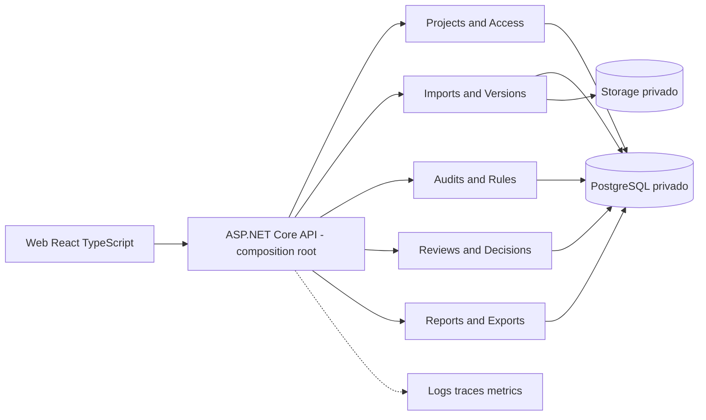

# ADR-001 — Monólito modular para o backend CronoCheck

- **Estado:** Proposto; decisão humana pendente (CRONO-006, [issue #10](https://github.com/OsvaldoSantana/cronocheck/issues/10)).
- **Data da proposta:** 2026-10-14.
- **Gates:** F00/G0 não aprovado; F01-E01/G1 não iniciados.
- **Fonte:** blueprint C.1–C.7 e F01-E01; PRD RF-01..11/RNF-05..10; glossário e invariantes CRONO-003.
- **Escopo da decisão:** fronteiras de deploy e de módulos do backend; **não** escolhe definitivamente provedor de hospedagem, banco ou identidade.

## Contexto e forças

O MVP exige upload/versão imutável de cronogramas, regras de auditoria puras e versionadas, achados explicáveis, decisões humanas e histórico transacional. Mutações críticas devem preservar **evento de auditoria atomicamente**; informações são autorizadas por projeto, com importações e execuções longas idempotentes. A carga, volume de organizações e equipe de engenharia **não têm medição empírica**; evitar separação distribuída antecipada.

### Critérios de comparação (qualitativos, sem medições inventadas)

| Critério | Peso conceitual | Por quê |
|---|---|---|
| Consistência, imutabilidade, eventos transacionais | Alto | RF-05, RF-08, RF-11, RNF-07 |
| Isolamento de autorização entre projetos | Alto | RF-01, RNF-06 |
| Agilidade de implantação, teste e operação | Alto | F01-E02 e F01-E04/G1 |
| Independência e disciplina dos módulos | Alto | Evolução de importação, auditoria e revisão |
| Escalabilidade operacional e filas | Médio | RNF-04 e jobs persistentes |
| Capacidade de deploy independente | Baixo, provisório | Sem demanda comprovada no MVP |
| Custo de infraestrutura e observabilidade | Médio | Evitar complexidade distribuída sem benefício |

## Alternativas consideradas

| Alternativa | Benefícios | Custos/risco | Avaliação para o MVP |
|---|---|---|---|
| A — Monólito em camadas, sem módulos explícitos | Menos estrutura inicial, setup simples | Fronteiras frouxas, consultas e modelos espalhados, acoplamento alto | Não preferida |
| **B — Monólito modular (proposta)** | Um backend implantável, transações locais, APIs internas tipadas e testes de fronteira | Exige disciplina de contratos e verificação arquitetural | **Preferida, aguardando aceite** |
| C — Microsserviços por domínio | Escala/deploy isolados e ownership distribuído | Transações distribuídas, observabilidade e contratos complexos, maior custo de DevOps | Rejeitar para MVP; reconsiderar sob evidência |
| D — Monólito separado em módulos executáveis (múltiplos deployments) | Autonomia parcial por processo | Reintroduz RPC e coordenação antes da necessidade | Adiar |

## Direção arquitetural proposta

**Um deploy lógico de API ASP.NET Core .NET 10 LTS**, com módulos internos e dependências
conhecidas. O projeto `CronoCheck.Api` é apenas **composition root**: registra endpoints,
autorização, injeção de dependência, pipelines, telemetria, health checks e interfaces
expostas por módulos; não concentra regras de importação/auditoria/revisão.

A representação é **lógica**. Cada seta módulo→PostgreSQL implica acesso **apenas ao próprio
modelo de persistência** por convenção/proteção verificável, não permissão para ler
diretamente tabelas de outro módulo.

### Responsabilidades e ownership de dados

| Módulo | Dono lógico de entidades/rotinas | Contratos autorizados com outros módulos |
|---|---|---|
| Projects & Access | Project, ProjectMembership, autorização por recurso | `ProjectAccessPolicy`, `ProjectReference` (propostos) |
| Imports & Versions | ScheduleImport, SourceFile, MappingProfile, ScheduleVersion, snapshots | `VersionReference`, `ValidatedScheduleSnapshot`, consultas públicas de versão |
| Audits & Rules | RuleSetVersion, AuditRun, Finding, evidências | entrada: referência imutável de versão; saída: resultados e evidências versionadas |
| Reviews & Decisions | FindingReview, decisões, atribuições e transições | entrada: referência de Finding; não modifica Finding original |
| Reports & Exports | jobs, artefatos temporários e formatos de exportação | consultas autorizadas por contratos públicos de versão/auditoria/revisão |
| Plataforma transversal | AuditEvent transacional, correlação, idempotência, jobs persistentes, storage adapters | políticas e interfaces pequenas, sem regras de negócio dentro do SharedKernel |

**Restrição:** não desenhar um `SharedKernel` como depósito de entidades ou serviços de
domínio. Compartilhar apenas tipos estáveis mínimos (IDs, resultado/erro, abstração de
tempo/transação caso justificada). Cada módulo pode usar um schema lógico próprio no mesmo
PostgreSQL, **se** testado e migrado independentemente; decisão de schemas/DbContexts é de ADR-003
e F01-E03, **não é aceita por este ADR**.

### Dependências permitidas (proposta de política)

- `Api` referencia contratos públicos e composição dos módulos.
- `Imports` publica snapshot imutável/referência; `Audits` consome contrato,
  não entidades EF internas do Imports.
- `Reviews` consome evidência/ID de Finding via API interna pública do Audits.
- `Reports` consome consultas públicas de Imports/Audits/Reviews, nunca DbContext privado.
- `Projects` define autorização por projeto consumida pelos módulos; nenhuma
  funcionalidade expõe dados sem a checagem no backend.
- Não permitir ciclos entre módulos, importações cruzadas de namespaces `*.Internal`
  ou SQL direto em tabelas alheias.
- `AuditEvent`: gravar na transação da mutação crítica; a lista de mutações e detalhes
  transacionais será definida em F03-E04, sem prometer outbox distribuído agora.

## Decisões de implementação **ainda não tomadas**

1. Estrutura exata de assemblies/soluções `.slnx`; validar durante F01-E02.
2. Um ou mais DbContexts e schemas; ADR-003 ainda não proposta/aceita.
3. Execução longa em hosted services ou processo de worker compartilhando banco;
   ADR-006 definirá durabilidade, claim e retry sem dupla execução.
4. Provedor OIDC/autorização detalhada; ADR-007 e OQ-04.
5. APIs entre módulos e mensagens de domínio; projetar quando casos F03–F07 existirem,
   com testes de arquitetura.

## Consequências

**Positivas:** transação local mais simples para AuditEvent e versões, menos pontos
de falha, debugging e testes de integração reprodutíveis, deploy inicial único.

**Negativas/mitigações:** um deploy backend comum gera acoplamento de release;
usar fronteiras testáveis e CI. Uma importação pesada pode competir por recursos
com consultas; prever job durável e quotas/limites antes de escalar. Evitar
`SharedKernel` amplo e dependência cruzada de entidades de persistência.

**Reversibilidade:** só separar serviço quando métricas reais comprovarem
necessidade (volume, latência, cadence de deploy, ownership de equipes, limites de
recursos). Exigir ADR nova com plano de migração, custo de consistência e rollback.
Nenhuma promessa de escala foi medida.

## Testes e critérios para futura aceitação

- Um smoke build e testes arquiteturais automatizados bloqueiam dependências
  proibidas (F01-E02/E04).
- Teste de autorização negativo entre projetos (RF-01) e de integridade de
  versão (RF-05) na F03/F04.
- Teste transacional de mutações críticas + AuditEvent (RNF-07).
- Testes de jobs idempotentes/concorrrentes em F04/F05, com PostgreSQL real efêmero.
- Observabilidade e correlação por requisição/job (RNF-09).

**Nenhuma verificação funcional acima foi executada.** A validação de CRONO-006 é
documental; o aceite deste ADR requer uma decisão expressa registrada com data e
responsável. O merge de PR não equivale a aceitar o ADR ou concluir G0/G1.

## Registro de decisão

- **Recomendação:** alternativa B — monólito modular.
- **Aceite:** pendente, não inferido.
- **Data/responsável/justificativa de aprovação:** preencher apenas após deliberação.
