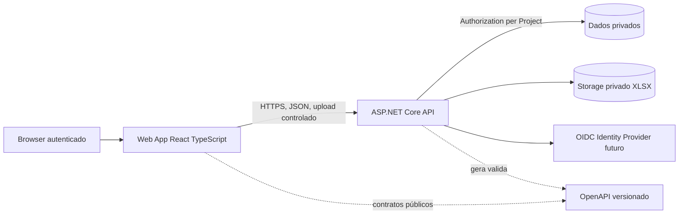

# ADR-002 — Interface React/TypeScript com fronteira explícita de API

- **Estado:** Proposto; decisão humana pendente (CRONO-006, [issue #10](https://github.com/OsvaldoSantana/cronocheck/issues/10)).
- **Data da proposta:** 2026-10-14.
- **Gates:** F00/G0 não aprovado; F01-E01/G1 não iniciados.
- **Fonte:** blueprint C.1–C.4, D.1–D.4, F01-E01; UX CRONO-005; RF-01..RF-11, RNF-01/02/06/09/10.
- **Escopo:** separação entre aplicação web e backend ASP.NET Core. A opção exata Vite/Next,
  provedor OIDC e hosting pertence à **OQ-04 ainda pendente**.

## Contexto e requisitos de UX

O produto precisa de wizard XLSX com estados de upload/mapeamento/prévia, filas de achados,
comparação de versões, histórico e navegação com filtros persistentes. Não há requisito
de indexação pública, conteúdo de marketing SEO ou SSR medido. A arquitetura
precisa de autorização no backend e acesso restrito a arquivos/dados de projeto,
com experiência responsiva e WCAG 2.2 AA nos fluxos essenciais.

## Alternativas comparadas

| Alternativa | Pontos favoráveis | Custos/riscos | Avaliação |
|---|---|---|---|
| **A — React/TypeScript SPA com Vite** | Ferramentas simples, separação clara UI/API, navegação rica, testes e entrega incremental | Bundle inicial, estados assíncronos e renovação de sessão precisam de disciplina; sem SSR público | **Preferida para experimentar, não aprovada** |
| B — React com Next.js e server rendering/BFF | SSR/roteamento e possíveis políticas BFF/sessão server-side | Duplica camada de backend em cenário de SPA privada; complexidade de hospedagem e segredos no runtime | Alternativa válida se auth, SSR ou BFF exigirem |
| C — UI server-rendered com ASP.NET Core Razor/Blazor Server | Menos stacks ou código .NET end-to-end | Diferente da proposta React do blueprint; interação contínua/wizard exige reavaliar stack e UX | Não preferida sem motivo comprovado |
| D — Frontend e endpoints acoplados em aplicação full-stack única | Deploy simplificado em alguns cenários | Fronteiras API/UI mais difíceis de manter; contraria separação prevista em C.1 | Alternativa a rejeitar inicialmente |

**Recomendação do CRONO-006:** separar frontend React/TypeScript e backend ASP.NET Core
por **contratos OpenAPI versionados**, preferindo **Vite para o protótipo/SPA interna
caso OQ-04 autorize**. Não converter essa recomendação em decisão de produção pelo
merge documental.

## Fronteiras propostas

- Web renderiza estados, menus e fluxos; não decide autorização de projeto.
- API valida recursos no servidor e não aceita `project_id` livre sem vínculo
  autenticado/permissionado; nenhuma leitura cruzada de projeto.
- Originais XLSX são privados; a UI não recebe caminho do filesystem, conexão
  de banco nem segredo operacional. Downloads assinados (se adotados) exigem TTL
  e autorização do recurso; decisão de storage ainda em aberto.
- A UI consome DTOs/API pública; não compartilha entidades EF Core nem classes
  internas do domínio. APIs documentadas, tratamento de erro/paginação, IDs de correlação.
- Jobs de importação/auditoria retornam status real e podem ser acompanhados após
  refresh; não depender de temporizador no browser para presumir conclusão.
- Estado de navegação persiste projeto/versão/filtro de forma explícita; valores
  sensíveis, tokens e dados brutos não são colocados em query strings.
- Estilos, tokens, Radix/shadcn, responsividade e acessibilidade seguem F02,
  sem forçar biblioteca visual como requisito irrevogável.

### Identidade e proteção da sessão: riscos reais a resolver

O frontend **não deve** persistir credenciais/segredos em `localStorage` como escolha automática.
Definir modelo de autenticação via ADR-007/OQ-04, avaliando OIDC Authorization Code + PKCE
para cliente público **versus** BFF/sessão segura no servidor. Para cada opção, documentar:
origem da sessão, CSRF se cookies, CORS (se origens distintas), `SameSite`,
`Secure`, `HttpOnly`, refresh e expiração, CSP e política de logout.

Não se assume implicitamente que SPA pura guarda tokens nem que cookies de sessão
resolvem CSRF. O transporte de identidade final e o domínio de deploy **seguem em aberto**.

## Contratos e responsabilidades

| Preocupação | UI | Backend | Evidência futura |
|---|---|---|---|
| Listar projetos | mostra apenas recursos retornados, estados vazios | autentica/autoriza por recurso | teste E2E + integração negativa |
| Importar XLSX | envia, mapeia, prévia e confirma | valida formato, conteúdo, limites e acesso | fixtures RF-03/04/05 |
| Auditoria | estado persistente real, link a achados | executa regras, versões e evidências | golden dataset RF-06/07 |
| Revisão | formulário e confirmação de decisão | máquina de estados, concorrência, AuditEvent | RF-08/11, RNF-07 |
| Diff | filtros e comparação legível | preserva IDs de versão e ambiguidades | RF-09 |
| Relatórios | seleção e download acessíveis | aplica escopo, sanitiza CSV/PDF | RF-10 e teste negativo |
| Compatibilidade | tipos DTOs e erros legíveis | OpenAPI versionada | RNF-10 em CI |
| Observabilidade | contexto e erros não sensíveis | correlation ID/trace | RNF-09 |

## Qualidade, deploy e riscos

- **Deploy separado por artefato:** build web estático/CDN e API própria são candidatos,
  não política de hospedagem decidida. Origens, cookies e cache exigem revisão na F01.
- **CORS e CSP:** aplicar menor privilégio, evitar `*` com credenciais e não habilitar
  origens arbitrárias; configuração exata depende da implantação.
- **Estados de erro:** tratamento uniforme de `401/403/404/409/422/429/5xx`
  conforme OpenAPI/ADR futuro; não prometer códigos por rota sem contrato.
- **Uploads e exportações:** proteção do servidor; frontend não sanitiza segurança sozinho.
- **Acessibilidade:** RNF-02 exige teclado, foco, leitor de tela, estados responsivos
  e redução de movimento; comprovada só depois de testes F02/F08.
- **Testabilidade:** Vitest/Testing Library para unidade/componentes,
  Playwright para jornadas e testes de contrato OpenAPI; F01-E04/F02-E06/F08.
- **Observabilidade:** erros de JS com contexto não sensível, IDs de correlação do
  servidor, sem gravação de arquivo XLSX inteiro em ferramentas de monitoramento.

## Reversibilidade e gatilhos para rever a escolha

Reavaliar Vite SPA versus Next/BFF **antes de F01-E02** após decidir OQ-04/ADR-007,
especialmente em caso de política obrigatória de cookies de sessão, requisitos SSR,
restrições de hospedagem ou compatibilidade. Migração de SPA para BFF **não é
gratuita**: implica revisar rotas, APIs, autenticação, testes E2E e operação.

## Verificação futura

- Fluxos FL-01..FL-05 cobertos por testes de tarefa e E2E quando implementados.
- Checagens de contrato OpenAPI e tipos cliente sem acesso a DTOs internos.
- Testes de autorização entre projetos, expiração de sessão, CORS/CSRF, uploads
  e erros de validação (RNF-06/RF-01/03).
- Smoke build e health check web + API com um comando reproduzível (F01-E02/G1).
- Acessibilidade dos fluxos críticos (RNF-02) verificada com ferramentas e testes manuais.

**Nenhum frontend/SSR/BFF foi criado ou testado.** Não interpretar a aprovação do PR
documental como aceite de OQ-04, ADR-002 ou Gate G0/G1.

## Registro de decisão

- **Recomendação:** alternativa A — React + TypeScript separado da API;
  Vite SPA preferida provisoriamente, sujeita à deliberação OQ-04/ADR-007.
- **Aceite:** pendente.
- **Data/responsável/justificativa de aprovação:** preencher somente após deliberação.
