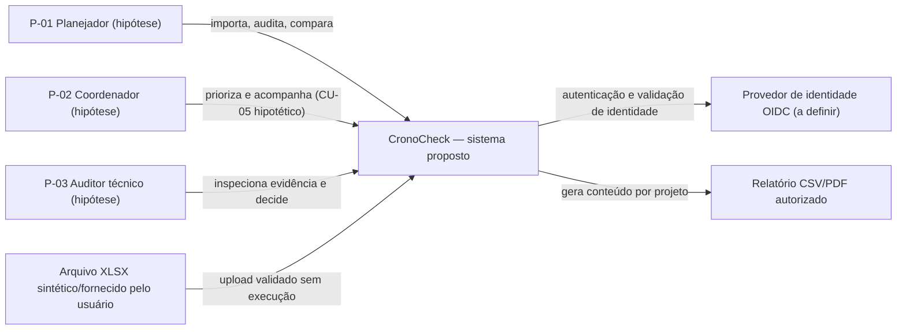
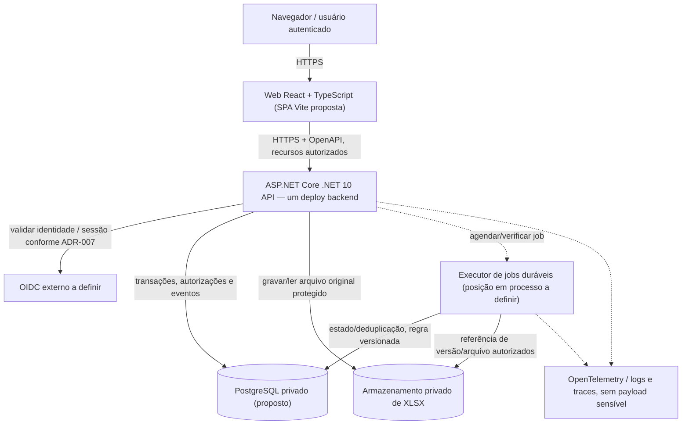
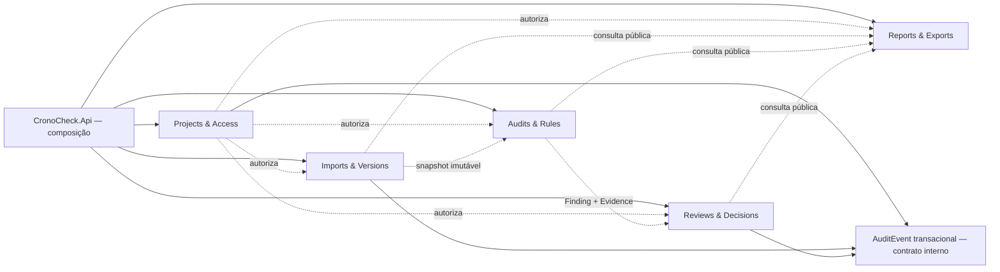

# CronoCheck — Contexto e contêineres propostos (C4 L1/L2 simplificado)

**Versão:** 0.1 · **Data:** 2026-10-14 · **Estado:** proposta para CRONO-006, [issue #10](https://github.com/OsvaldoSantana/cronocheck/issues/10).  
**Fontes:** blueprint C.1–C.7 e F01-E01; PRD, requisitos RNF-06/07/09/10,
[ADR-001](adr/ADR-001-modular-monolith.md), [ADR-002](adr/ADR-002-frontend-boundary.md),
[fluxos UX](../ux/flows.md).

## 1. Propósito e fronteiras

CronoCheck é um produto proposto de auditoria **determinística, explicável e versionada**
de cronogramas, com revisão e decisão **humanas**. O MVP contempla acesso por projeto,
XLSX, persistência de origem, regras, achados, decisões, comparação e relatórios.

Esta página usa notação Mermaid para mostrar **relações conceituais**, não um diagrama
de infraestrutura implantada ou um contrato de rede aprovado. OQ-04 continua pendente:
não foram escolhidos hosting, identidade, CORS, DNS, BFF ou deployment final.

## 2. Nível C4 L1 — Contexto de sistema

**Atores não validados:** P-01..03 são personas hipotéticas; integração nativa de
Microsoft Project/Primavera, cobrança multiempresa e IA não fazem parte do MVP.

## 3. Nível C4 L2 — Contêineres e canais de confiança

A caixa `JOB` é uma **responsabilidade lógica**: não pressupõe serviço externo
nem microsserviço. Workers hospedados podem compartilhar deploy ou executar
como processo dedicado quando ADR-006 decidir persistência, retries e isolamento.
As conexões exatas de navegador e identidade dependem do fluxo OIDC/BFF e da
separação de origens. **Não assumir token no localStorage ou cookie sem CSRF**.

### Responsabilidades e dados confiados

| Contêiner | Responsabilidade | Nunca deve fazer |
|---|---|---|
| Web UI | Renderização acessível, wizard, filtros, tabelas, estados reais, navegação | Conceder autorização no cliente, executar fórmula XLSX, guardar segredos backend |
| API | Autenticação/autorização, validação, transações, contratos OpenAPI, composition root | Expor conexões/segredos ou delegar autorização exclusivamente ao frontend |
| Execução longa | Importação/auditoria assíncrona com estado durável e retries | Considerar timeout HTTP prova de sucesso/falha; executar duas vezes sem política |
| Banco privado | Projetos, versões normalizadas, achados, revisões, AuditEvent | Expor acesso direto ao navegador; permitir escrita irrestrita entre módulos |
| Storage privado | Guardar bytes do XLSX de origem, vinculados a hash e acesso autorizado | Hospedar XLSX de cliente publicamente ou executar conteúdo incorporado |
| Provedor de identidade | Autenticar usuário via padrão aberto/consolidado | Substituir regra de acesso **por projeto** da aplicação |
| Observabilidade | Identificadores de correlação, estados e diagnóstico operacional | Registrar documentos/credenciais/PII sem necessidade |

## 4. Domínios no backend monolítico

Direção de seta **conceitual**, não referência de assembly aprovada. A política
obrigatória proposta é impedir **acesso a persistência interna de outros módulos**
e ciclos, ver ADR-001. `AuditEvent` é requisito transversal (RNF-07), sem criar
um "microsserviço de eventos" no MVP. Não presume módulo Reports escrevendo
diretamente no banco de Revisões.

## 5. Fluxos arquiteturais críticos

### Fluxo A — Importação confirmada (RF-03..05)

1. Navegador inicia importação com projeto explícito, autorização verificada pelo servidor.
2. API valida tamanho/tipo/ZIP/OOXML e guarda bytes de origem em armazenamento privado.
3. UI permite selecionar aba/mapear colunas, obtém prévia sem criar versão.
4. Servidor revalida prévia, autorização e chave de idempotência na confirmação.
5. Cria `ScheduleVersion` e snapshot, preservando origem, SHA-256 e `SourceLocator`.
6. Executa/aagenda auditoria futura por versão e RuleSet, com estado durável.

**Não inferir** persistência final da versão apenas por progresso do upload. A
coerência transacional entre SQL e storage (dois recursos) e compensações será
decidida em F04/ADR-004; não é garantida atomicidade intersistemas pelo ADR-001.

### Fluxo B — Auditoria, revisão e exportação (RF-06..11)

1. Motor lê snapshot imutável autorizado e conjunto versionado de regras.
2. `AuditRun` armazena status e resultados determinísticos com evidência e regra.
3. Usuário autorizado revisa `Finding`, confirma uma transição e fornece justificativa.
4. Backend faz controle de concorrência e persiste mutação + `AuditEvent` juntos.
5. Relatório CSV/PDF contém somente dados permitidos e metadados de versão/regra.

**A decisão humana não modifica o Finding original.** Não incluir dados confidenciais
de usuário/cliente em URLs de navegação ou traces.

## 6. Qualidade, limites e gate

| Necessidade | Evidência técnica futura | Etapa |
|---|---|---|
| Fronteiras sem ciclos | teste de arquitetura no CI usando projetos/assemblies | F01-E04 |
| Build e setup reproduzíveis | frontend + backend compiláveis com um comando | F01-E02 |
| PostgreSQL/migrações | ambiente local limpo + migração inicial | F01-E03 |
| Contratos OpenAPI | diffs de schema + smoke | F01-E05 |
| Correlation ID | trace atravessando API e job | F01-E06 |
| Segurança por projeto | testes positivos/negativos, incl. exportação | F03/F04/F07 |
| Integridade e idempotência | testes com PostgreSQL e fixtures, rollback/eventos | F03..F05 |
| UX acessível | teste real de teclado, foco, leitor de tela e tarefa | F02/F08 |

**Nenhum desses testes de aplicação foi executado.** CRONO-006 registra propostas,
sem iniciar formalmente F01 ou antecipar G1/G0. Hosting, OIDC e semântica de domínio
continuam pendentes.
