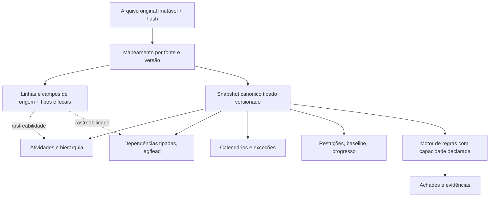

# CronoCheck — Requisitos de modelagem robusta e extensível (OQ-03)

**Status:** diretriz de produto aprovada em 15/10/2026; **detalhamento de implementação e conformidade pendente**.  
**Referência:** `decisions-2026-10-15.md`, `domain-glossary.md`, `domain-invariants.md`, PRD v1.2 e blueprint v1.0.  
**Impacto:** exige emenda e reavaliação do escopo de domínio antes da aprovação do PRD e Gate G0.

## 1. Princípio diretor

O CronoCheck deve representar a semântica e a origem de cronogramas
profissionais **sem reduções silenciosas**. A robustez aplica-se a
atividades, dependências, campos, calendários, restrições e identificadores,
e não exclusivamente ao campo de predecessoras.

Isso exige uma **camada canônica tipada**, um **snapshot bruto de origem**
e mecanismos versionados de extensão por formato/fonte. Não significa
substituir todos os campos por strings ou por um único objeto arbitrário:
isso reduziria a confiabilidade do motor de auditoria.

## 2. Informações necessárias do domínio (catálogo inicial para análise)

| Grupo | Representação esperada | Atenção para compatibilidade e evidência |
|---|---|---|
| Atividade e origem | Chave interna, ID externo bruto, nome, campos adicionais, origem por aba/linha/célula | IDs externos duplicados não são chave interna; OQ-09 aprovada |
| Estrutura WBS | Pais/filhos, marcos e tarefas de resumo, profundidade e ordenação | Resumo não é automaticamente executável, nem todas as fontes usam hierarquia igual |
| Datas e tempo | Instante com offset/zona quando existir; data civil se só essa informação existir; granularidade registrada | Não transformar data civil em instante UTC ou eliminar timezone |
| Duração | Quantidade, tipo (elapsed/working/estimate etc.), unidade, calendário, precisão e origem | Marcos podem ter duração zero; não usar dias corridos inclusivos universalmente |
| Dependências | Predecessora, sucessora, relação **FS/SS/FF/SF**, lag/lead com sinal, unidade, calendário e fonte | Múltiplas predecessoras; referência ausente/ambígua preservada |
| Calendários | Semanas/turnos, feriados, exceções, fusos, herança e vínculo a atividade/recurso | Cálculo requer regras explícitas, não inferência a partir do nome |
| Restrições | Datas máximas/mínimas, fixed start/finish, deadline, tipo de constraint, origem | Não forçar um único tipo para todas as fontes |
| Baseline e progresso | Data base, versões, percentual, duração restante/real, marcos planejados | Distinguir previsto, realizado e replanejado |
| Identidade entre versões | Chave da versão, ID de origem, proveniência e método declarado de correspondência | Não casar automaticamente IDs repetidos ou renomeados |
| Campos externos | Nome original, tipo detectado, valor bruto, unidade/locale, versão de formato, status de suporte | **Preservar** desconhecidos; plugin/adaptador interpreta quando versão e teste existirem |

O catálogo é inicial, **não** uma alegação de cobertura universal.
Mecanismos de formatação e critérios de conformidade precisam de casos
representativos da população real de cronogramas.

## 3. Estrutura conceitual, não DDL

**Capacidade declarada por regra:** o motor deve distinguir
`supported`, `partially_supported`, `unsupported` e
`invalid_input`. `unsupported` não autoriza calcular resultado
distorcido como se os dados fossem interpretados integralmente.

Campos estendidos devem usar namespaces/schemas versionados, validação
de tipo, normalização e controle de acesso. O snapshot bruto permite
evoluir os adaptadores sem destruir o dado original.

## 4. Requisitos de qualidade derivados da diretriz

1. **Sem perda silenciosa:** guardar original e campo bruto, tipo/locale,
   `SourceLocator` e diagnóstico de interpretação.
2. **Separação entre representação e auditoria:** importar um relacionamento
   desconhecido de forma auditável não significa auditá-lo corretamente.
3. **Sem truncar relações:** múltiplos predecessores, lag/lead, calendários
   distintos e hierarquia preservados quando a origem os fornecer.
4. **Extensão testável:** adicionar tipos/adaptadores sem alterar os invariantes
   do núcleo; contratos, migrations e regras versionados.
5. **Precisão adequada:** unidades, timezone, precisão, datas e marcos
   identificados explicitamente; conversão somente com política publicada.
6. **Segurança e determinismo:** valores externos não viram fórmulas executáveis
   ou SQL; motor usa versão de regra + modelo normalizado rastreável.
7. **Capacidade mensurável:** desempenho aferido com classes de cronogramas,
   dependências e calendários, não apenas número de linhas XLSX (OQ-05).

## 5. Casos mínimos para evoluir fixtures (a criar após decisão do contrato)

| Cenário planejado | Conteúdo | Resultado a testar no futuro |
|---|---|---|
| DOM-DEP-01 | FS, SS, FF e SF combinados | Todos representados com tipo exato; regra específica apenas se implementada |
| DOM-DEP-02 | Lag positivo, lead negativo e unidades diferentes | Sinal/unidade/calendário preservados |
| DOM-DEP-03 | Diferentes calendários nas atividades | Não calcular dependência assumindo dias corridos |
| DOM-ACT-04 | Marco duração zero, atividade resumo e WBS profunda | Entidades tipadas corretamente sem eliminar linha |
| DOM-TIME-05 | Data civil, timestamp com offset e timezone | Sem mudança silenciosa de dia ao normalizar |
| DOM-SRC-06 | Campo desconhecido, formatos de célula heterogêneos | Snapshot bruto preservado com status de suporte |
| DOM-IDENT-07 | IDs duplicados em versões distintas | Identidade interna e conciliação ambígua explícitas |

Nenhuma dessas fixtures avançadas foi criada nesta rodada. As dez fixtures
pré-existentes continuam válidas **para seu perfil sintético v0** (OQ-08).
O alcance temporal, o algoritmo de calendário, o catálogo de formatos
e os limites de volume são decisões de engenharia **a especificar e testar**,
não resultados já disponíveis.

## 6. Critérios antes de estabilizar PRD/G0

- [x] Diretriz OQ-03 contra restrição FS-only registrada.
- [x] Componentes de modelo extensível e campos relevantes catalogados.
- [ ] Atualizar PRD para uma versão revisada e estimar impacto em custo,
      duração, cobertura de regras e aceitação da release.
- [ ] Definir testes e formatos-alvo representativos; entrevistas com
      planejadores reais ainda pendentes (OQ-01).
- [ ] Acordar semântica de calendários, restrições, unidades e vínculos.
- [ ] Fixar política de funcionalidades parcialmente suportadas sem mascarar
      resultado; testes antes da F04/F05.
- [ ] Aprovação expressa da baseline PRD revisada e Gate G0.

**Conclusão:** OQ-03 define o objetivo de modelagem. A especificação da
cobertura efetiva, o escopo de regras e o aceite do PRD permanecem pendentes.
