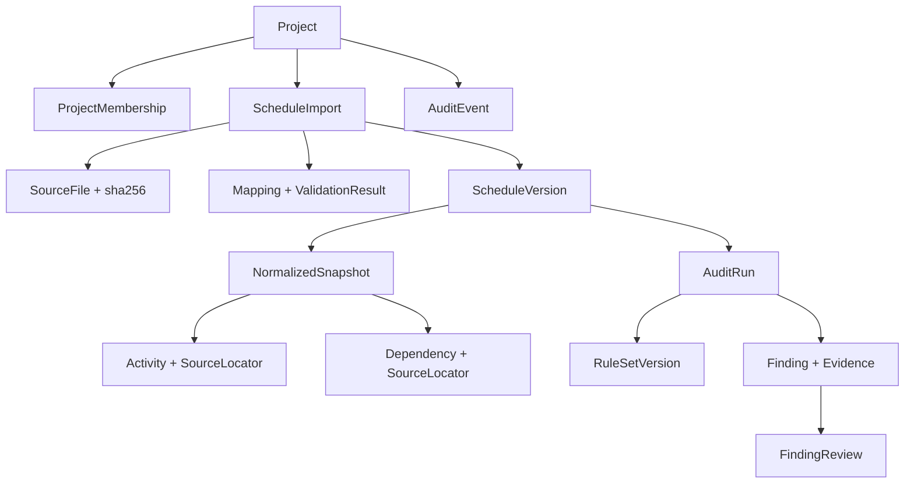

# CronoCheck — Glossário de domínio e modelo conceitual v0.1

> **Nota de 15/10/2026:** OQ-03 estabelece modelo profissional extensível com FS/SS/FF/SF, lag/lead, calendários, durações e campos externos preservados sem perdas; OQ-09 aprova identidade interna distinta da origem. Ver `dependency-domain-requirements.md` e `decisions-2026-10-15.md`. Detalhes algorítmicos continuam por especificar.

**Ticket:** [CRONO-003 / Issue #4](https://github.com/OsvaldoSantana/cronocheck/issues/4)  
**Fase:** F00 — descoberta · **Data:** 2026-10-14  
**Estado:** proposta técnica versionada, aguardando revisão humana. **Não é** implementação nem decisão arquitetural aprovada.  
**Fontes:** blueprint v1.0 (A, B, C.5–C.7, E/F00), PRD v1.2, contrato XLSX v0.1 e fixtures da F00-E04.

## 1. Convenção de autoridade

- **[BASELINE]** — conceito expressamente previsto no blueprint/PRD, sem declarar sua implementação.
- **[PROPOSTO]** — desenho de domínio para análise e posterior aprovação; não altera automaticamente os contratos existentes.
- **[PENDENTE]** — requer deliberação ou prova empírica antes de impor comportamento definitivo.

O contrato XLSX atual é um **perfil sintético de referência**, não o formato único aceito pelo produto. A aprovação OQ-02 autoriza dados sintéticos, **não** aprova calendários, dias corridos inclusivos ou tipos definitivos de dependência.

## 2. Mapa conceitual

O desenho indica dependências **conceituais**. Não especifica tabelas, DDL, módulos distribuídos ou classes C#.

## 3. Vocabulário controlado

| Termo | Definição operacional | Autoridade | Fronteira / ressalva |
|---|---|---|---|
| **Workspace** | Contexto organizacional ou de uso que agrupa recursos, caso venha a existir. | [BASELINE] menção em C.5 | A relação Workspace/Project não é uma política multiempresa aprovada; SaaS multiempresa está fora do MVP. |
| **Project** | Unidade de autorização e acompanhamento que contém versões e auditorias do cronograma. | [BASELINE] | As referências devem manter `project_id` para impedir acesso cruzado. |
| **ProjectMembership** | Associação de usuário, papel e escopo de acesso ao projeto. | [BASELINE] | Papéis/permissões concretos aguardam F03 e testes de autorização. |
| **ScheduleImport** | Tentativa de receber, verificar e mapear arquivo de cronograma; guarda origem, autor, SHA-256, estado e erros de importação. | [BASELINE] | Tentativa de importação **não equivale** a versão confirmada. |
| **SourceFile** | Arquivo original recebido, preservado sem execução nem edição automática. | [BASELINE] | Conteúdo privado; hash SHA-256 dos bytes, não do nome ou da planilha normalizada. |
| **MappingProfile** | Associação entre aba/colunas de origem e chaves esperadas do contrato de entrada. | [PROPOSTO] | Wizard permitirá mapear layouts heterogêneos; edição de proposta não altera versão existente. |
| **ValidationResult** | Registro de erros impeditivos e warnings durante leitura e prévia. | [BASELINE] | Separado de achados calculados pelo motor de auditoria. |
| **ScheduleVersion** | Versão numerada por projeto que referencia arquivo de origem, mapeamento e snapshot normalizado. | [BASELINE] | Uma vez confirmada, **não sobrescrever**; novas confirmações criam novas versões salvo retry idempotente. |
| **NormalizedSnapshot** | Retrato tipado dos dados aceitos para uma versão, com procedência de cada linha e referência. | [PROPOSTO] | Não corrigir silenciosamente duplicatas, datas invertidas ou predecessoras ausentes. |
| **SourceLocator** | Localização rastreável de uma informação na entrada: aba, linha e, se aplicável, coluna/célula. | [PROPOSTO] | `source_sheet/source_row` já constam do contrato XLSX v0; não confiar na numeração exibida pela UI sem origem. |
| **Activity** | Unidade de planejamento importada, contendo identidade interna, ID de origem, título, datas, duração e hierarquia opcional. | [BASELINE] | ID interno não deve usar somente `activity_id`, pois a origem pode conter IDs repetidos. |
| **SourceActivityId** | Identificador fornecido no cronograma, como `A001`. | [PROPOSTO] | Preservar valor bruto e, quando necessário, forma normalizada; escopo por versão, **não global**. |
| **ActivityIdentity** | Chave interna única, independente da possibilidade de duplicidade do ID de origem. | [PROPOSTO] | Estratégia exata (chave substituta/snapshot/linha) permanece em OQ-09. |
| **Dependency** | Ligação lógica entre predecessora e sucessora, com tipo e defasagem quando conhecidos. | [BASELINE] | O modelo futuro deve permitir registrar vínculos não suportados sem convertê-los incorretamente. |
| **PredecessorReference** | Token bruto extraído da célula de predecessoras, com linha/célula e resolução explícita. | [PROPOSTO] | Pode estar resolvido, ausente, ambíguo (ID duplicado) ou ser não suportado. |
| **FS / Finish-to-Start** | Relação em que o término da predecessora condiciona o início da sucessora. | [BASELINE] suporte inicial limitado | Não concluir equação de horário/defasagem sem definir calendário e granularidade; OQ-03 pendente. |
| **Calendar** | Definição de dias, horários e exceções de trabalho para converter durações/defasagens e verificar relações. | [BASELINE] necessidade | Calendários úteis, feriados, turnos e conversão de unidades **não estão definidos** no perfil XLSX v0. |
| **CivilDate** | Data de calendário, como `2026-11-02`, sem horário nem timezone. | [PROPOSTO] conforme contrato XLSX | Não representar com UTC 00:00 como se fosse um instante. |
| **Instant** | Momento de evento operacional em UTC (ex.: upload/decisão/execução). | [BASELINE] | Exibir em timezone local na UI sem perder UTC da origem. |
| **CalendarDayDuration** | Duração expressa em dias corridos; fixture v0 usa contagem inclusiva de datas. | [PROPOSTO] | **Não equivalente** a horas trabalhadas, dias úteis ou duração Microsoft Project; OQ-08 pendente. |
| **WorkingDuration** | Duração baseada em unidade de trabalho e calendário associado. | [PROPOSTO] conceito futuro | Não computada pelas fixtures v0; sem fórmula aprovada para produção. |
| **Lag** | Defasagem positiva/negativa de vínculo, associada a unidade e calendário. | [BASELINE] atributo de Dependency | Não inferir minutos/dias úteis a partir de número sem unidade; interpretação pendente. |
| **Hierarchy/ParentActivity** | Relação de organização entre atividade e elemento-pai. | [BASELINE] opcional | Não assumir que linha de resumo é atividade executável; comportamento de roll-up será definido depois. |
| **RuleSetVersion** | Identificador e versão do catálogo/configuração de regras usado em uma execução de auditoria. | [BASELINE] | A versão das regras deve ser reproduzível independentemente da execução. |
| **AuditRun** | Execução ligada a uma versão de cronograma e versão de regras, com estado, horário e correlação. | [BASELINE] | Reexecutar gera novo registro; não reescreve resultados históricos. |
| **Finding** | Achado produzido por regra, com severidade, evidência e referências à versão e entidades afetadas. | [BASELINE] | Não confundir com erro impeditivo de importação nem com decisão humana. |
| **Evidence** | Conjunto de entradas, origem, versão de regra e raciocínio verificável que sustenta o achado. | [BASELINE] | Evidência não deve desaparecer quando usuário rejeita/justifica achado. |
| **FindingFingerprint** | Identificador estável para correlacionar achados equivalentes. | [BASELINE] requisito de rastreabilidade | Esquema de canonicalização/versionamento permanece para F05; não usar carimbo de execução no fingerprint. |
| **FindingReview** | Estado, responsável, justificativa e decisão humana sobre um achado. | [BASELINE] | Uma decisão de revisão não apaga o Finding original. |
| **AuditEvent** | Registro de ação crítica com ator, recurso, momento UTC, correlação, resultado e delta seguro. | [BASELINE] | Evento de negócio escrito atomicamente com a mutação relevante; diferente de logs técnicos. |
| **VersionDiff** | Comparação entre snapshots do **mesmo projeto** que identifica adições, remoções e modificações. | [BASELINE] função do MVP | Pareamento por ID de origem só é seguro se único/inequívoco; ambiguidades devem ser exibidas. |

## 4. Identidade e endereçamento

A referência de origem e a chave interna respondem a perguntas diferentes:

| Pergunta | Referência sugerida | Observação |
|---|---|---|
| Que linha do Excel gerou este registro? | `SourceLocator(sheet, row, column?)` | Pode apontar inclusive para ID repetido ou linha rejeitada. |
| Que atividade armazenamos nesta versão? | `ActivityIdentity` + `ScheduleVersionId` | Deve ser unívoca, independentemente do ID de origem. |
| Qual era a identificação fornecida pelo planejador? | `SourceActivityId` | Preservar string original e a regra de normalização aplicada. |
| Que vínculo foi escrito originalmente? | `PredecessorReference` bruto | Não substituir uma referência ausente por null sem evidência. |
| Qual atividade corresponde à da versão anterior? | `VersionDiff` com regra explícita de pareamento | Não inferir igualdade por posição da linha ou título. |

Exemplo: duas linhas com `D001` em `duplicate-ids.xlsx` exigem **duas entidades
distintas** e um achado de duplicidade. Nenhuma delas deve ser escolhida silenciosamente como
destino único de uma predecessora `D001`. Se o importador não puder resolver, o vínculo permanece
**ambíguo**, com evidência na linha de origem; a política final de resolução é a OQ-09.

## 5. Semântica de dados temporais (não aprovada para produção)

O perfil do fixture `Activities` utiliza:
- `start_date` / `finish_date`: datas civis ISO, em texto.
- `duration_calendar_days`: inteiro positivo, contagem **inclusiva proposta**.
- `predecessors_fs`: lista de IDs, separada por vírgulas, sem defasagem.
- `parent_activity_id`: opcional, vazio nos fixtures iniciais.

Essas escolhas apenas tornam os testes sintéticos determinísticos. Em cronogramas reais,
duração pode ser em minutos/horas trabalhadas, calendário customizado, datas com horários
e vínculos FS/SS/FF/SF com lag/lead. **Não aplicar automaticamente**
`finish - start + 1` como verdade profissional: OQ-08 e OQ-03 não foram aprovadas.

A expressão “a predecessora terminou antes da sucessora iniciar” não define, sozinha,
um algoritmo de validação para dois valores `CivilDate` sem horários de início/fim e calendário.
A futura regra temporal deve indicar granularidade, unidade e tolerância para evitar falsos
positivos e negativos.

## 6. Ciclos de vida conceituais

| Objeto | Fluxo proposto | O que não pode ocorrer |
|---|---|---|
| `ScheduleImport` | Recebida → Validando → Prévia disponível / Rejeitada → Confirmada | Prévia criar `ScheduleVersion` silenciosamente |
| `ScheduleVersion` | Confirmada → Histórico consultável | Edição destrutiva de versão histórica |
| `AuditRun` | Pendente → Executando → Concluída / Falhou | Reexecução sobrescrever resultados anteriores |
| `FindingReview` | Aberta → Em revisão → Decidida | Decisão sem trilha, ator ou transição válida |
| `VersionDiff` | Solicitação → Comparação → Resultados / Ambiguidades | Assumir correspondência sem identificar critério |

**Estados acima são propostas de linguagem, não máquinas de estados aprovadas**;
transições exatas e privilégios serão definidos nas fases de implementação.

## 7. Fronteiras entre importação e auditoria

- **Importação rejeitada:** conteúdo ilegível/inseguro, colunas não mapeadas ou tipo inválido
  segundo contrato; não cria versão. Casos: `invalid-dates.xlsx` e `formula-cells.xlsx`.
- **Importação aceita com inconsistência estrutural:** preserva registros parseáveis e
  permite auditoria posterior. Casos: `duplicate-ids.xlsx`, `missing-predecessor.xlsx`,
  `dependency-cycle.xlsx` e `inconsistent-dates.xlsx`.
- **Achado auditado:** consequência de regra declarada e versionada aplicada à versão, não
  erro do parser; pode ser revisada sem alterar o arquivo de origem.

Categorias em `expected-results.json` são **asserções planejadas**, não prova de motor
de auditoria implementado. A validação Python de OOXML no PR #3 não substitui testes da API C#.

## 8. Rastreabilidade e próximas decisões

| Tema | Relacionamento | Status |
|---|---|---|
| Autorização do projeto | RF-01, RF-02, C.5 | MVP requerido; implementação F03 |
| Fluxo e contrato XLSX | RF-03–RF-05, F00-E04 | Contrato proposto, dados sintéticos aprovados |
| Auditoria e achados | RF-06, RF-07, RF-11, F05 | Regras ainda não implementadas |
| Comparação de versões | RF-09, CU-02, F07 | Pareamento com ambiguidade explícita |
| Tipos FS e defasagens | OQ-03 | Pendente |
| Datas civis, duração, fórmulas | OQ-08 | Pendente |
| Identidade e referências ambíguas | OQ-09 | **Nova proposta; pendente** |
| UX de revisão | RF-08, CU-03, F06 | Estados e permissões futuras |

## 9. Critério de saída CRONO-003

- [x] Vocabulário e relações conceituais documentados.
- [x] Distinguidos identificadores de origem, identidade interna e proveniência de linhas.
- [x] Definidas fronteiras entre erros de importação, inconsistências e achados.
- [x] OQ-03/OQ-08 identificadas como pendências; nova OQ-09 registrada.
- [ ] Revisão humana do glossário e das ambiguidades.
- [ ] Aprovação das decisões necessárias para implementação.
- [ ] Atualização do Gate G0 após revisão de todas as entregas da F00.

**Este documento não autoriza iniciar a Fase 01 ou implementar regras/calendários.**
