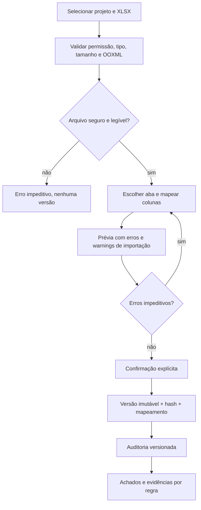

# CronoCheck — Contrato de importação XLSX v0

> **Nota de decisão de 15/10/2026:** OQ-03 rejeita FS-only como limite do produto; OQ-08 aprova **somente a convenção das fixtures sintéticas v0**. `predecessors_fs` e `duration_calendar_days` não definem o modelo canônico final. A interpretação profissional exige expansão de contrato e do PRD. Ver `decisions-2026-10-15.md`.

> **Estado:** proposta técnica da F00-E04, para revisão humana.  
> **Data:** 2026-10-14 · **Revisão:** 0.1  
> **Decisões relacionadas:** OQ-02 aprovada (usar exclusivamente dados sintéticos); OQ-03 pendente (escopo final de precedências); OQ-08 proposta (semântica exata do contrato v0).  
> **Requisitos:** RF-03, RF-04, RF-05; apoio a RF-06, RF-09 e RNF-05/06/07.  
> **Escopo:** especificação de entrada e dados de teste; **não** implementa parser, motor de regras ou persistência.

## 1. Objetivo e princípios

Definir um formato XLSX de **referência sintética** para orientar o futuro wizard de mapeamento, a
normalização e os testes. Não impor este layout como único formato aceito de clientes: na F04, o
usuário poderá selecionar aba e mapear colunas heterogêneas, sem perda silenciosa de dados.

- A operação de **prévia/validação** não cria `ScheduleVersion`.
- Somente a **confirmação explícita** cria a versão, preservando arquivo de origem, SHA-256,
  configuração de mapeamento e snapshot normalizado.
- Uma planilha **parseável** pode conter inconsistências que pertencem à auditoria. Essas
  inconsistências não devem impedir automaticamente uma versão de ser criada.
- Um documento ou campo **ilegível/inseguro** deve falhar antes da confirmação, com motivo
  recuperável por humanos e máquinas.
- A abordagem inicial com datas civis ISO e duração em dias corridos é **provisória**;
  cronogramas profissionais podem usar calendário útil, durações trabalhadas, turnos,
  fusos e defasagens, que exigem decisão e modelo mais amplo.

## 2. Workbook de referência v0

| Propriedade | Proposta v0 |
|---|---|
| Extensão | `.xlsx` (OOXML válido, não confiar só na extensão) |
| Planilha | `Activities` (nome padrão para fixtures); wizard permitirá escolha |
| Cabeçalho | Primeira linha, sem mesclas, texto exato no exemplo; aliases/mapeamentos são parte de F04 |
| Dados | Uma linha física por atividade; linha 2 em diante; linhas vazias finais ignoráveis |
| Codificação | Células XLSX usuais, texto Unicode, sem depender de localidade |
| Escopo de IDs | Por versão de cronograma (não globais entre projetos) |
| Fonte | Somente dados fictícios/sintéticos, sem cliente/obra/pessoa real |
| Quantidade | 5.000 atividades no cenário de carga proposto, sem impor limite definitivo de upload |
| Fórmulas | Proposta conservadora: **rejeitar** fórmulas em campos mapeados, não avaliá-las nem confiar no cache |

### Colunas

| Chave canônica sugerida | Tipo lógico | Obrigatório | Exemplo | Política v0 |
|---|---|---|---|---|
| `activity_id` | string | Sim | `A001` | `trim` de espaços externos; preservar grafia; duplicatas **não são corrigidas** nem mescladas |
| `name` | string | Sim | `Fundação sintética` | Texto não vazio após `trim`; nunca executar conteúdo |
| `start_date` | ISO date-only | Sim | `2026-11-02` | Interpretar apenas `YYYY-MM-DD` nas fixtures |
| `finish_date` | ISO date-only | Sim | `2026-11-03` | Interpretar apenas `YYYY-MM-DD` nas fixtures |
| `duration_calendar_days` | integer | Sim (referência) | `2` | `>=1`; duração inclusiva proposta, em **dias corridos**, não duração trabalhada |
| `predecessors_fs` | string/lista de IDs | Não | `A001,A003` | IDs separados por vírgula; ordem estável; sem defasagem; só FS nesta amostra |
| `parent_activity_id` | string | Não | `A000` | Relação hierárquica opcional; no conjunto inicial permanece vazia |

**Importante:** `duration_calendar_days` não pretende substituir o modelo profissional de
duração/calendário do produto. É uma simplificação explicitamente reversível e pendente de revisão
(OQ-08). Datas como **texto ISO** são intencionais: forçam um teste de interpretação
independente das configurações regionais do Excel. Datas numéricas nativas, formatos brasileiros,
células de data, e formatos heterogêneos serão tratados por testes de F04 depois de decididos.

## 3. Semântica e normalização propostas

1. O arquivo original é imutável e recebe `sha256` do **conteúdo em bytes**, não do nome.
2. `ScheduleVersion` tem ID interno, número sequencial por projeto e vínculo ao autor/projeto.
3. Toda linha recebe `source_sheet` e `source_row` para rastrear erros e achados; o identificador
   de origem `activity_id` é preservado mesmo quando duplicado.
4. O ID interno canônico **não deve** depender apenas do `activity_id` de origem (que pode ser
   repetido). A decisão final do identificador interno é parte do desenho do domínio na F04.
5. `start_date`/`finish_date` representam dias civis sem timezone; timestamps transacionais
   de importação permanecem em UTC. Não converter data civil para timestamp UTC.
6. A hipótese para `duration_calendar_days` em uma linha normal é
   `finish_date - start_date + 1`, usando dias corridos. **Não** calcular fins de semana/feriados
   nesta fixture v0. A política e o conjunto de testes temporais dependem de OQ-03/OQ-08.
7. Uma dependência `P -> S` significa `P` predecessora de `S`. O campo é lista de IDs; valores
   desconhecidos são mantidos para a auditoria, nunca silenciosamente removidos.
8. O conjunto de regras do futuro motor é **versionado**. Identificadores de resultados
   neste pacote são categorias de teste (`duplicate_activity_id`, etc.), **não** IDs de regras
   R-001...R-NNN definitivos.

### Tratamento de valores anômalos

| Entrada | Etapa | Tratamento v0 proposto |
|---|---|---|
| Arquivo que não é ZIP/OOXML ou pacote corrompido | Importação | Erro impeditivo `IMP_INVALID_XLSX`; nenhuma versão criada |
| Aba obrigatória ausente / colunas não mapeáveis | Prévia/mapeamento | Erro impeditivo `IMP_MAPPING_REQUIRED`, com possibilidade de remapear |
| Fórmula em coluna mapeada | Prévia | Erro impeditivo `IMP_FORMULA_IN_MAPPED_CELL`; não executar fórmula |
| Data ISO impossível ou ilegível | Prévia | Erro impeditivo `IMP_INVALID_DATE` apontando aba, linha e coluna |
| Duração não numérica / não positiva | Prévia | Erro impeditivo de tipo `IMP_INVALID_DURATION_TYPE` (proposta) |
| ID duplicado | Auditoria | Achado `duplicate_activity_id`, preservando ambas as linhas |
| Predecessora inexistente | Auditoria | Achado `missing_predecessor`, preservando referência original |
| Ciclo de precedências | Auditoria | Achado `dependency_cycle`, sem tentar quebrar o ciclo automaticamente |
| `finish_date < start_date` | Auditoria | Achado `reversed_date_range`, sem correção automática |
| Duração positiva diferente de datas inclusivas | Auditoria | Candidato `duration_mismatch`; comportamento final depende de OQ-08 |
| Tipo SS/FF/SF ou defasagem fora do modelo de referência | Mapeamento / auditoria | Aviso claro de recurso não suportado; **não** interpretar como FS silenciosamente |

A distinção entre erros impeditivos e achados evita a contradição de bloquear todas as versões
que o motor de auditoria precisa examinar. O conjunto de achados por fixture é especificado no
`tests/fixtures/expected-results.json`.

## 4. Workflow da importação (contrato comportamental)

A prévia deve exibir valores brutos, valores normalizados, `source_sheet/source_row`,
motivos de rejeição e avisos. Não ocultar linhas problemáticas. O backend revalida ao confirmar:
a prévia não substitui autorização, limites nem validação transacional.

### Idempotência e concorrência

- Refresh da página ou retry da mesma confirmação não cria uma segunda versão por acidente.
- Identidade de operação (`idempotency_key`) + escopo do projeto + integridade do arquivo
  devem ser verificados antes de aceitar retry, sem confiar somente no nome de arquivo.
- Upload e confirmação não devem aceitar dados de outro projeto/usuário.
- F04 decide tempos de retenção, armazenamento seguro, tokens temporários e limites por
  ambiente; esta proposta não inventa valores definitivos.

## 5. Ameaças e limites a cobrir na implementação

- Validar estrutura OOXML e conteúdo real; rejeitar caminhos de arquivo perigosos,
  macros/artefatos fora do contrato e uploads não autorizados.
- Inspecionar entradas comprimidas por contagem de entradas, tamanho descompactado, taxa
  de expansão, profundidade e consumo de CPU/memória; não abrir ZIP cegamente.
- Não executar fórmulas, links externos, conexões, macros nem conteúdo incorporado.
- Tratar conteúdo de célula como dado não confiável; escapar exportação CSV
  contra injeção de fórmulas.
- Manter linhas, erros e informações técnicas no contexto de projeto, com autorização
  obrigatória no backend.
- Não publicar amostras reais no repositório público.

## 6. Fixtures e casos esperados

`tests/fixtures/README.md` documenta os cenários. O manifesto
`tests/fixtures/expected-results.json` define o conjunto inicial de asserções de
importação e categorias estruturais de auditoria, além da comparação entre versões.
Não presumir resultados de algoritmos ainda não implementados.

Casos básicos:
- `basic-valid.xlsx`: importação bem-sucedida, 4 atividades, sem achados estruturais.
- `duplicate-ids.xlsx`: duas linhas com mesmo ID; importável, um grupo duplicado.
- `missing-predecessor.xlsx`: referência inexistente; importável, achado de referência.
- `dependency-cycle.xlsx`: três atividades em ciclo; importável, achado de ciclo.
- `invalid-dates.xlsx`: string de data impossível; bloqueio de importação.
- `inconsistent-dates.xlsx`: fim anterior ao início; importável, achado de cronologia.
- `formula-cells.xlsx`: fórmula em campo mapeado; bloqueio de importação sem executar fórmula.
- `large-5000-activities.xlsx`: 5.000 atividades, referência de volume; benchmark futuro, não SLA.
- `multi-version-v1.xlsx` e `multi-version-v2.xlsx`: comparação sintética, com adição, remoção
  e modificação esperadas.

Casos futuros fora desta entrega: acesso entre projetos (requer RF-01/RF-02 implementados),
arquivo malicioso/suspeito (somente laboratório controlado com threat modeling),
locale Excel, datas serializadas, fórmulas/caches variados e calendários úteis.

## 7. Decisões em aberto e aprovação

| ID | Pergunta | Proposta para experimentação v0 | Estado |
|---|---|---|---|
| OQ-03 | Somente FS simples no MVP? | Fixtures FS apenas; não inferir aprovação para produção | Pendente |
| OQ-08 | Precisão de datas, duração, regras de duplicidade e fórmula | Data civil ISO texto, dias corridos inclusivos, duplicata como achado e fórmula como erro de prévia | **Pendente de aprovação** |
| OQ-04 | Stack / hospedagem final | Fora desta etapa | Pendente |

A decisão OQ-02 de uso de dados sintéticos **está aprovada**, mas não aprova automaticamente
o modelo profissional de calendário, as escolhas de normalização nem o Gate G0.

## 8. Critérios de saída da etapa F00-E04

- [x] Contrato de referência com tipos, campos, fluxo, erros e limites documentado.
- [x] Fixtures geradas, inspecionadas estruturalmente no GitHub Actions (run 38629233298) e versionadas na branch com expected result — revisão humana ainda pendente.
- [ ] Revisão humana da semântica proposta e registro de deliberação sobre OQ-08.
- [ ] Confirmar rastreabilidade RF-03/RF-04/RF-05/RF-06 e RNF relevantes.
- [ ] Aprovação explícita de F00-E04/G0 quando aplicável.

**Nenhum parser foi implementado; este documento é uma especificação proposta.**
