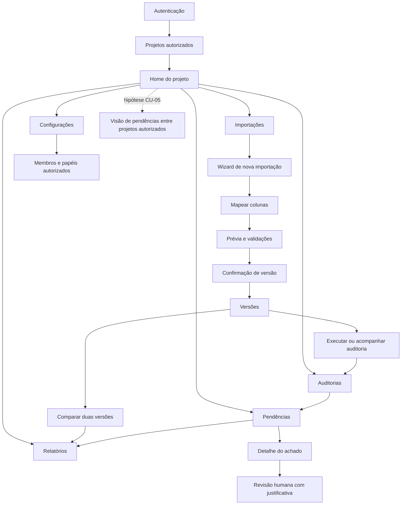
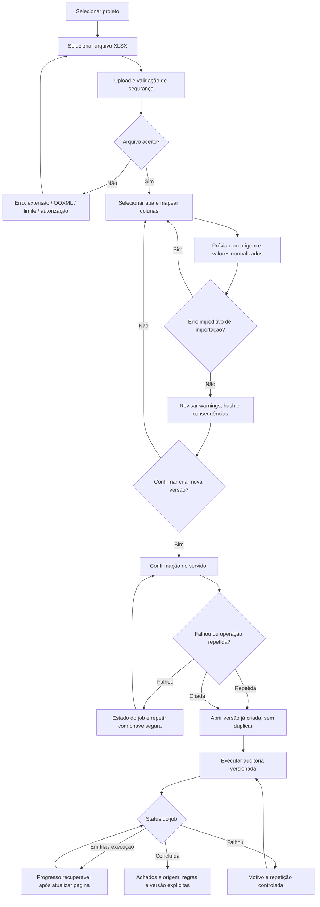
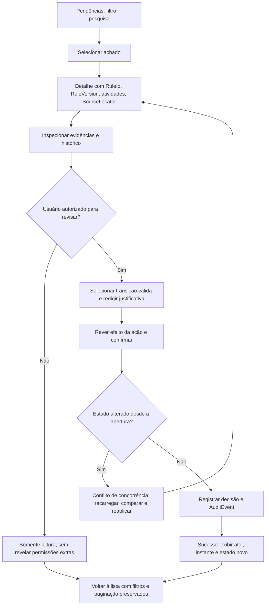
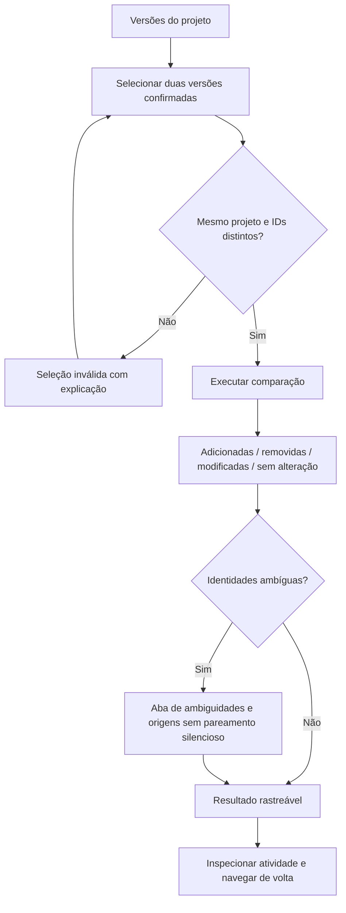

# CronoCheck — CRONO-005: Fluxos de UX e navegação (v0.1)

**Etapa:** F00 / CRONO-005 — [Issue #8](https://github.com/OsvaldoSantana/cronocheck/issues/8).  
**Estado:** proposta documental para revisão humana; **não** é UI implementada, protótipo clicável ou validação de usuários.  
**Fontes:** blueprint §§A.7, D.1–D.4, E/F00-E02, E/F02; PRD §§5–9; [jornada hipotética](../product/journey-as-is-to-be.md); [contrato XLSX v0](../product/xlsx-import-contract-v0.md); [glossário](../product/domain-glossary.md).  
**Decisões de domínio:** OQ-01/02 aprovadas apenas para documentação hipotética e dados sintéticos; OQ-03..09 não aprovadas. CU-05 depende de OQ-07.

## 1. Princípios UX observáveis

1. **Contexto persistente:** projeto, versão de cronograma e execução de auditoria ficam evidentes e não mudam silenciosamente.
2. **Ação antes de gráfico:** a home indica pendências e próximo passo; números permitem ir à evidência, não apenas visualizar dashboards.
3. **Sem perda de trabalho:** filtros e paginação permanecem na volta; rascunhos de mapeamento exibem opção de recuperar/descartar, sujeita à política de retenção futura.
4. **Explicabilidade:** cada achado mostra regra/versão, atividades, fonte (aba, linha/célula) e diferença entre resultado da máquina e decisão humana.
5. **Erros sem ambiguidade:** diferenciar falha de arquivo/mapeamento de achado de auditoria; não afirmar que um cronograma está "correto" só porque não há achados.
6. **Permissão por recurso:** não exibir dados não autorizados; os controles visuais nunca substituem validação no backend.
7. **Estados explícitos:** empty, loading, success, error, permission-denied, conectividade intermitente, conflito e retry; não inferir conclusão de um job a partir de timeout da página.
8. **Acessibilidade e responsividade:** foco visível, ordem de tabulação, labels, mensagens associadas, teclado e leitura por leitor de tela; redução de movimento.

## 2. Arquitetura de informação (rótulos do blueprint preservados)

- **Projetos:** lista, seleção e home operacional do projeto; membros/papéis somente para quem tiver permissão.
- **Importações:** novas importações, progresso persistente, prévia, mapeamento e versões confirmadas.
- **Auditorias:** execuções por versão, conjunto de regras, status, detalhes e evidências.
- **Pendências:** lista de achados filtrável, responsável, severidade, decisão e trilha.
- **Relatórios:** consulta autorizada e exportação CSV/PDF com metadados.
- **Configurações:** permissões do projeto e preferências do usuário, sem inventar funções pós-MVP.

O menu principal pode estar associado ao **contexto de projeto**; a seleção/troca de projeto é separada e sempre visível. "Todos os projetos" só é permitido para conteúdos realmente autorizados (CU-05 ainda hipotético).

### Sitemap conceitual

## 3. Rotas candidatas, não contrato de frontend

| Tela | URI ilustrativa | Contexto obrigatório | Entrada/saída principal |
|---|---|---|---|
| Acesso | `/login` | sessão | autenticar → projetos |
| Projetos | `/projects` | usuário autorizado | selecionar → home |
| Home de projeto | `/projects/:projectId` | projeto | navegação/CTA “Importar cronograma” |
| Importações | `/projects/:projectId/imports` | projeto | histórico → nova importação |
| Wizard | `/projects/:projectId/imports/new` | projeto | arquivo → mapeamento → prévia → confirmação |
| Versões | `/projects/:projectId/versions` | projeto | selecionar versão e auditoria |
| Auditorias | `/projects/:projectId/audits` | projeto, versão opcional | execuções → achados |
| Pendências | `/projects/:projectId/findings` | projeto, versão, execução | lista → detalhe |
| Detalhe do achado | `/projects/:projectId/findings/:findingId` | projeto, achado e versão | regra/evidência → revisão |
| Comparação | `/projects/:projectId/versions/compare` | duas versões do mesmo projeto | diferenças → relatório |
| Relatórios | `/projects/:projectId/reports` | projeto e escopo autorizado | filtro → exportar |
| Configurações | `/projects/:projectId/settings` | projeto | membros/papéis com controle |
| Visão multiprojeto | `/projects/attention` | projetos autorizados | prioridade → projeto; **hipótese CU-05** |

**Não implementar as URIs agora.** São nomes legíveis propostos, sujeitos a ADRs e ao desenho F02-E01. IDs usados na URL não são controles de autorização. O estado de filtros e paginação pode ser serializado na URL com parâmetros permitidos; não incluir tokens, dados sigilosos ou destinos arbitrários. Um link de retorno deve ser interno e validado, não permitir redirecionamento aberto.

## 4. Mapa de jornadas e rastreabilidade

| Cenário | Persona hipotética | Fluxo | RF associados | Ponto de decisão |
|---|---|---|---|---|
| **CU-01** | P-01 Planejador | FL-01 — Importar e auditar | RF-01, RF-02, RF-03, RF-04, RF-05, RF-06, RF-07 | confirmar versão só com prévia válida |
| **CU-02** | P-01 / P-02 | FL-03 — Comparar versões | RF-05, RF-09 | identidade ambígua não produz pareamento silencioso |
| **CU-03** | P-03 Auditor | FL-02 — Investigar e decidir achado | RF-07, RF-08, RF-11 | transição só após evidência e confirmação |
| **CU-04** | P-03 / P-02 | FL-04 — Exportar | RF-10, RF-11 | acesso e escopo do relatório conferidos |
| **CU-05** | P-02 Coordenador | FL-05 — Priorizar pendências | RF-02, RF-07, RF-08 | **hipótese em OQ-07**, não validada |

### FL-01 — Upload XLSX → auditoria explicável

**Fronteiras críticas:** (a) prévia não gera versão; (b) importação pode ser aceita com
IDs duplicados, predecessor inexistente ou datas invertidas — problemas são **achados
de auditoria**, não necessariamente erros impeditivos; (c) datas ilegíveis, fórmula
em célula mapeada e mapeamento incompleto são rejeições **propostas** no contrato v0
(OQ-08 pendente); (d) ao cancelar, não declarar arquivo armazenado/excluído sem
política efetiva de retenção.

### FL-02 — Lista de achados → evidência → revisão

**Revisar não é apagar:** Finding, RuleVersion e Evidence permanecem visíveis. Estados de revisão
exatos, transições e obrigatoriedade da justificativa ainda dependem de F06; os controles
do wireframe são **conceituais** e não aprovam uma máquina de estados.

### FL-03 — Comparação de versões (CU-02)

### FL-04 — Exportação CSV/PDF (CU-04)

Filtrar consulta autorizada → verificar projeto/versão/regras/execução → prévia de
metadados e escopo → solicitar exportação → resultado ou falha recuperável →
conferir arquivo. O sistema escapa valores perigosos para CSV e aplica permissão
do servidor na geração, não apenas na tela.

### FL-05 — Home operacional e priorização (CU-05, não aprovada)

Home do projeto → pendências críticas / importações recentes → abrir achado no
contexto da versão correta → atribuir se autorizado. A extensão para **vários**
projetos é uma hipótese pendente OQ-07 e não deve justificar acesso irrestrito nem
saltar a validação de papéis.

## 5. Regras de navegação e preservação de contexto

| Transição | Contexto mantido | O que fazer diante de desatualização |
|---|---|---|
| Projetos → Projeto | `projectId` validado pelo servidor | retornar seleção ou informar sem acesso |
| Projeto → Wizard | projeto atual, intenção de importação | se sessão expirar, solicitar nova autenticação e validar estado antes de continuar |
| Versões → Auditorias | `projectId`, `scheduleVersionId` | mostrar versão imutável e última auditoria disponível, nunca substituir por outra silenciosamente |
| Pendências → Achado | filtros, ordenação, página, contexto da auditoria | voltar para consulta anterior; se achado mudou, sinalizar conflito |
| Achado → Atividade | versão, identificador interno e `SourceLocator` | não resolver ID de origem duplicado por correspondência arbitrária |
| Comparação → Detalhe | IDs de versões base/alvo no mesmo projeto | não aceitar outra versão sem ação explícita |
| Relatório → Arquivo | versão, regras, filtros e permissão | exibir dados efetivos de exportação e permitir repetir quando falhar |

## 6. Estados de tela e conteúdo (aplicam-se a todos os fluxos)

| Estado | Comportamento esperado | Evitar |
|---|---|---|
| Inicial / vazio | explicar o que falta e oferecer CTA autorizado | tabela vazia sem explicação |
| Loading | anunciar operação em andamento; preservar contexto | spinner eterno sem estado do servidor |
| Sucesso | informar o que foi persistido, versão e próxima ação | “concluído” antes da confirmação do servidor |
| Erro de prévia | indicar aba, linha, coluna, valor e ação corretiva | erro genérico sem causa |
| Warning / achado | expor regra e evidência após auditoria; não bloquear importação por padrão | “corrigir” dados silenciosamente |
| Permissão negada | mensagem neutra, sem vazar existência do projeto | mostrar dados sensíveis antes de negar |
| Conectividade instável | permitir nova tentativa segura e retomar job pelo servidor | assumir que upload/decisão falhou por timeout |
| Conflito (revisão) | comparar estado atual e solicitar nova confirmação | sobrescrever decisão de outro usuário |
| Sem achados | “nenhum achado detectado pelas regras executadas” | “cronograma 100% correto” |

## 7. Padrões de acessibilidade e comportamento

- Hierarquia de títulos e regiões semânticas; breadcrumb + título identificam o projeto e a
  versão, sem depender de cor.
- Cada etapa do wizard tem título, número, estado atual e lista de erros; foco vai para
  erro/resumo de validação e volta de modo previsível.
- Para upload, disponibilizar botão acessível além de drag-and-drop; aceitar teclado
  e alternativa à interação por mouse.
- Inputs mapeados têm label, descrição de finalidade, erro associado, tipo e exemplo;
  confirmação de ação irreversível exige contexto e foco dentro do diálogo.
- Jobs longos: `role=status`/equivalente anuncia alterações relevantes sem
  flood de mensagens; não inferir tempo restante sem medida real.
- Tabelas: ordenação, busca, filtros e seleção acessíveis, sem depender apenas de hover.
- Gráficos nunca são única representação; estados também precisam de texto e
  tabelas com valores reproduzíveis.
- Texto, ícones e contraste devem poder alcançar **WCAG 2.2 AA** nos fluxos essenciais
  (RNF-02), a verificar após implementação e revisão manual.
- Layout proposto funciona em mobile com menus recolhíveis, cards/linhas legíveis,
  ações primárias acessíveis, conteúdo sem scroll horizontal obrigatório no fluxo;
  tabela densa pode permitir rolagem controlada com cabeçalhos acessíveis.

## 8. Entradas para F02 e perguntas não resolvidas

| Questão | Impacto UX | Decisão ainda necessária |
|---|---|---|
| OQ-03 | Tipo FS e vínculos não suportados na prévia | delimitar avisos e regras temporais |
| OQ-05 | Prazos percebidos no wizard e jobs | benchmark e limites reais, sem cronômetro inventado |
| OQ-06 | Ponto de entrada no histórico de alterações | AuditEvent base em F03, consulta completa posteriormente |
| OQ-07 | Navegação e fila multiprojeto | validar CU-05 e permissão agregada |
| OQ-08 | Data, duração, fórmula, marcos de duração zero | rótulos e mensagens de validação provisórios |
| OQ-09 | IDs duplicados, referência ambígua, diff | comportamento explícito sem pareamento silencioso |

## 9. Critérios de saída CRONO-005 (documentais)

- [x] Navegação proposta preserva as seis seções e as nove telas do blueprint.
- [x] FL-01/FL-02 cobrem importação→auditoria e revisão→histórico, com desvios.
- [x] CU-01..CU-05 mapeados, identificando CU-05 como hipótese.
- [x] Condições de erro, repetição, autorização, job longo e conflito registradas.
- [x] Regras de contexto, retorno, teclado e acessibilidade documentadas.
- [ ] Wireframes revisados pelo responsável pelo produto.
- [ ] Rotas e nomenclatura validadas com usuários e engenheiros da F02.
- [ ] Evidência de teste de usabilidade realizada com usuários (nenhuma existe).
- [ ] Aprovação formal de CRONO-005 e dos gates aplicáveis.

**Apenas especificação. F00-E02, CRONO-001 e Gate G0 permanecem pendentes de aceite humano.**
